# Finalysis

Local-first personal financial analytics: import bank and card statements, categorize spending,
and ask questions about your own data. Spring Boot backend + React (Vite, TypeScript) frontend.
Features and their status are tracked in [docs/requirements.md](docs/requirements.md).

```
backend/      Spring Boot 4 REST API (Java 21, Maven wrapper) — runs on :8080
frontend/     React 19 + Vite app — runs on :5173, proxies /api to :8080
sample-data/  Synthetic bank and card statements (see "Sample data")
postman/      Postman collection and local environment for the API
scripts/      Developer scripts (dev database reset)
tools/        Sample data generator
compose.yaml  Postgres 17 + pgvector
```

## Local development

**Prerequisites:** JDK 21+, Node.js 22+, Docker (for the database and for Testcontainers).

```sh
cp .env.example .env          # then set POSTGRES_PASSWORD
docker compose up -d db

# Terminal 1 — backend (Flyway applies migrations at startup)
cd backend
./mvnw spring-boot:run

# Terminal 2 — frontend
cd frontend
npm install
npm run dev
```

Open http://localhost:5173 for the app ([The app](#the-app)). The backend listens on 127.0.0.1 only.

### Tests

```sh
cd backend && ./mvnw verify
cd frontend && npm test              # Vitest; results also in frontend/test-reports/vitest.json (git-ignored)
cd frontend && npm run test:layout   # Playwright: every screen at 375 px and 1280 px, API from fixtures
```

Backend tests always run against a throwaway Testcontainers Postgres and never touch the dev
database. `DevDatabaseGuard` fails any test context whose datasource points at the compose database.
All test contexts share one container, so `backend/src/test/resources/application.properties` keeps
each context's connection pool at 3; Spring caches about ten contexts per run.

### Postman

`postman/` holds a collection with tests for every endpoint and a local environment
(`baseUrl` = `http://localhost:8080`). It runs top to bottom against a **freshly reset** dev
database: **1. Setup** creates the four sample accounts, saves the Apex mapping by hand and the
Summit mapping from the preview's suggestion, imports four statements (two `IMPORTED`, one
`RECONCILED`, one `NEEDS_REVIEW`), imports the April checking statement a second time into a
second checking account with the same last four at another institution (the "wrong account"
story), and uploads a PDF no parser recognizes.
Folders 2, 3 and 5 read accounts, mappings, previews and categories. **4. Statements, transfers and
review queue** reads statements, then resolves every item in the review queue through the API:
links a card payment by hand, confirms, unlinks and relinks it, marks one-sided transfers and joins
a possible match, accepts the statement needing review, dismisses the upload, deletes the wrong
statement and imports it again to produce a competing candidate. **6. Errors** sends a request for
each error the sample files can trigger. **8. Categorization** runs categorization with and without
`ai` and with `force`, reads a txn's category fields, corrects a category and undoes it with its rule
(`removeRule=true`), marks a CAT-08 suggestion not a transfer and undoes that, resolves another
suggestion as one-sided, reads the review queue by kind, and creates, deactivates and deletes a rule.
Its ids and expected counts come from the API, not from hard-coded descriptions. **9. Analytics**
imports the rest of the sample months (Apex May to October and Summit May to September with their
periods and balances, checking June to September as OFX), then reads coverage, closes, reopens and
closes again the "wrong account" copy so the later months can be complete, and checks the totals
against each other: the accounts add up to the household, the category rows to each month, every
drill-down to the cell it opens, the merchants to the month's spending, the trends to the months, and
each recurring series to its charges. It lists the alerts (every basis must satisfy observed ≥
threshold), checks the Safeway duplicate and Spotify's price increase to the cent, and dismisses and
restores the duplicate. Money is compared in whole cents.
Setup is strict, so a second run without a reset fails.

**Newman runs with AI off** (no `aws` profile). Every AI request in the run asserts `status: OFF`
and 0 calls, so the run never reaches Bedrock. **12. Chat (AI off)** creates, reads and deletes a
conversation, checks that a turn returns the `ai-off` problem (503) and stores nothing, that a
question over 1,000 characters is a 400, and that no chat request changes data: six reads (months,
categories, a drill-down total, the transaction count, alerts, recurring charges) are saved before
the chat requests and compared field by field after them. Three folders are manual and left out of the run:
**7. Real-file test** (your own files, below), **10. Lookups** (a txn by id, coverage counts) and
**11. Live AI (aws profile)**, which makes live Bedrock calls and needs the backend started with
`SPRING_PROFILES_ACTIVE=aws`. In the Collection Runner, untick those three.

```sh
scripts/reset-dev-db.sh                    # wipes the dev database; see below
(cd backend && ./mvnw spring-boot:run)     # in another terminal, without the aws profile
npx newman run postman/Finalysis.postman_collection.json \
    -e postman/Finalysis-Local.postman_environment.json --working-dir . \
    --folder "1. Setup" --folder "2. Accounts" --folder "3. CSV mappings and preview" \
    --folder "4. Statements, transfers and review queue" --folder "5. Categories" --folder "6. Errors" \
    --folder "8. Categorization" --folder "9. Analytics" --folder "12. Chat (AI off)" --folder "13. UI reads"
```

Run newman from the repo root: uploads use paths such as `sample-data/ofx/…`. In the Postman app,
import both files, select the **Finalysis Local** environment, set the working directory
(Settings → General) to the repo root, and run the collection with the **Collection Runner**.
`payload-too-large`, `unsupported-currency`, `ambiguous-format` and `mapping-changed` need files
or timing the sample data can't provide; the backend tests cover them.

The `--folder` flags leave out **7. Real-file test**, which is for manual runs with your own
statement: in the Postman app, select the file in **Preview real file** and **Import real file**,
send the first six requests in order, and read the results in the Postman console. **Create real
account** and **Create real card account** accept a `409 account-exists` and reuse the existing id, so
the folder can be sent again without a reset. To test transfers
between two of your own accounts, also select your card file in **Preview real card file** and
**Import real card file** and send the remaining seven requests: they create a second account
("Real Card"), import into it, run detection, and list the transfer links and the review queue. Those
three log counts, account ids and dates only, never amounts or descriptions. The folder asserts
nothing; untick it in the Collection Runner.
Real statements stay in `private-data/`; don't save a file selection or response into the collection.

### Database client

To browse the dev database with DBeaver or a similar client, create a PostgreSQL connection with
host `localhost`, port `POSTGRES_PORT` (default 5432), database `POSTGRES_DB`, and user and password
from `.env`. The port is bound to 127.0.0.1 only. Tick **Read-only connection** (in DBeaver, on the
connection's General page): the schema belongs to Flyway and the data to the app.

### Resetting the dev database

> ⚠️ **`scripts/reset-dev-db.sh` permanently deletes all local data:** every account, statement,
> and transaction in the dev database. There is no undo.

```sh
scripts/reset-dev-db.sh
```

The script removes the compose `db` container and its `pgdata` volume, then starts a fresh empty
database. It removes only the database volume, which it resolves from `docker compose config` and
checks by its compose labels; other services and their volumes are never touched. Start the backend afterwards so Flyway re-applies the migrations. It asks you to type
`reset` to confirm. It refuses to run if it is given any arguments, if stdin is not a terminal, or
if anything suggests a non-local target: a remote `DOCKER_HOST` or Docker context, `DOCKER_CONTEXT`,
`COMPOSE_FILE`, `COMPOSE_PROJECT_NAME` or `SPRING_DATASOURCE_URL` set, or a `POSTGRES_HOST` other
than localhost.

## The app

Eight tabs behind the menu button, dark by default with a light switch, one responsive layout from 375 px up (UI-01,
UI-02, UI-03, UI-05, UI-07). Every figure on screen comes from the API as a string: the frontend never computes a
total, average or percent (a test fails any screen file that parses a value into a number). Screenshots are from the
synthetic sample data. The month picker, the cloud-AI strip (whenever cloud AI is on, UI-05) and the menu are on every
tab.

### Overview

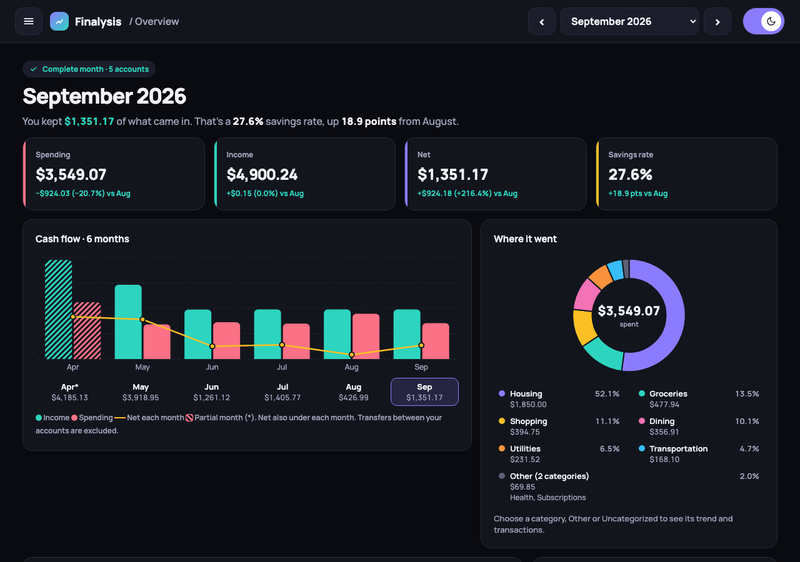

The month's spending, income, net and savings rate with their change from last month, six months of cash flow, where
the money went by category, the newest alerts, recurring charges and the data-quality tile, all from one read
(`GET /api/dashboard`). A category, Other or Uncategorized opens its details: its trend, top merchants, and its
transactions with a ✓ when they add up to the figure clicked (`GET /api/dashboard/details`, UI-04).

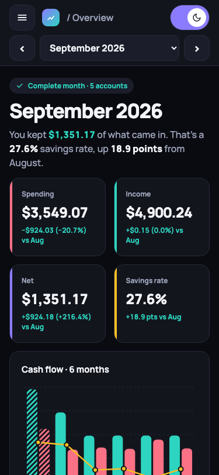

### Transactions

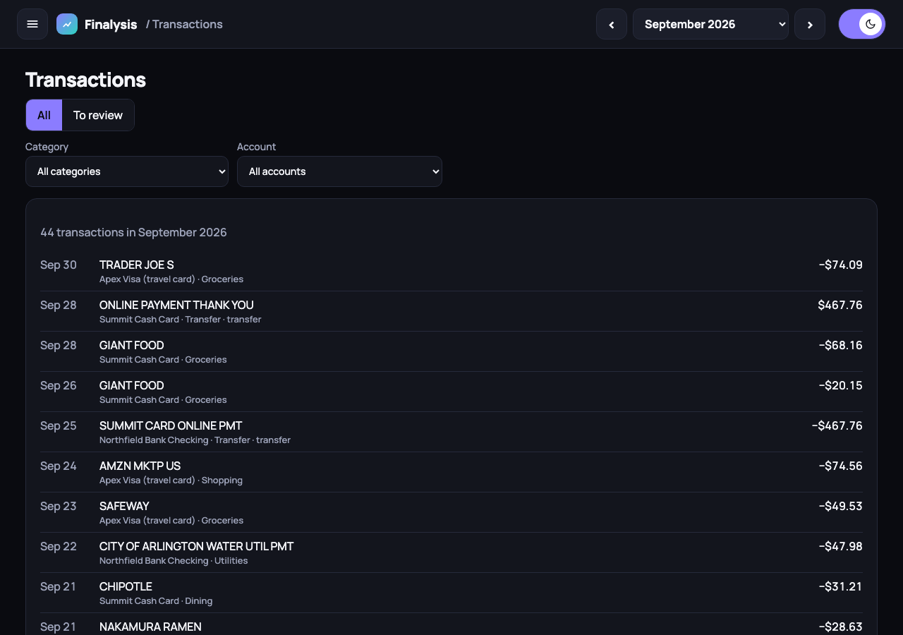

The month's transactions with category and account filters, or one statement's. **To review** lists what needs a
category, every month, with why it waits, and **Categorize now** runs the rules and Corgi over them. A row opens its
sheet: the statement and the line it came from (UI-04), the category and who set it (a rule, you, or Corgi), and the
corrections (set a category, undo, not a transfer).

### Import

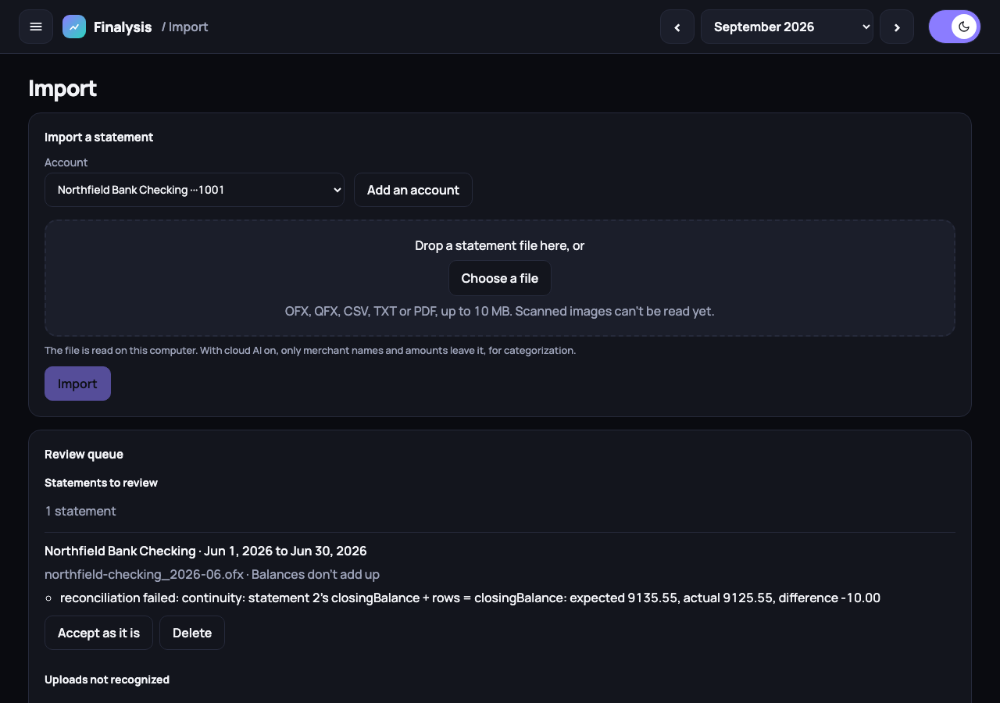

Choose an account (or add one), drop one statement file, and see the import's result as the API returns it. A CSV
without a mapping shows its first rows and the suggested mapping; when the sign is a guess, you say which way the file
prints purchases. Below: the review queue (statements to review, uploads not recognized, transfer matches) and the
statements by account, each with delete (UI-02).

### Alerts and Recurring

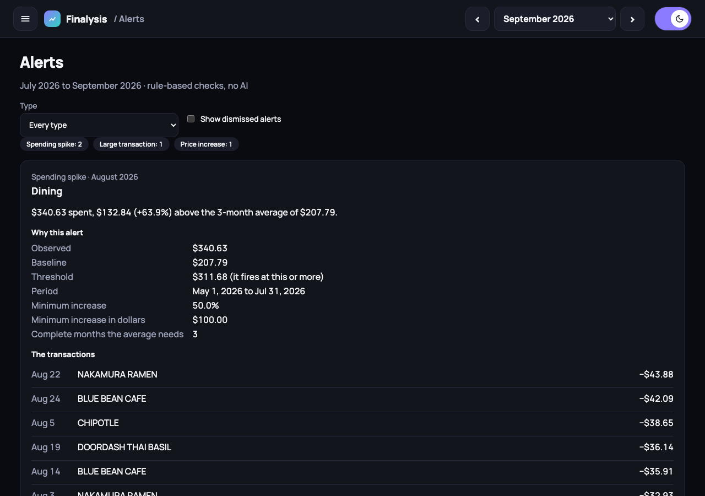

Alerts for the picked month and the two before it, each with its basis (observed, baseline, threshold) and its
transactions; dismiss and restore. Recurring lists monthly charges, active and ended, with their typical and last
amounts and the next expected date.

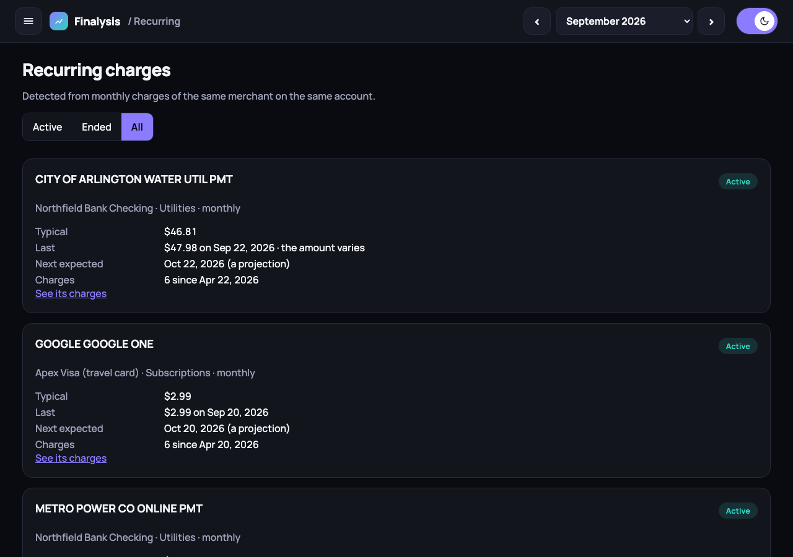

### Chat with Corgi

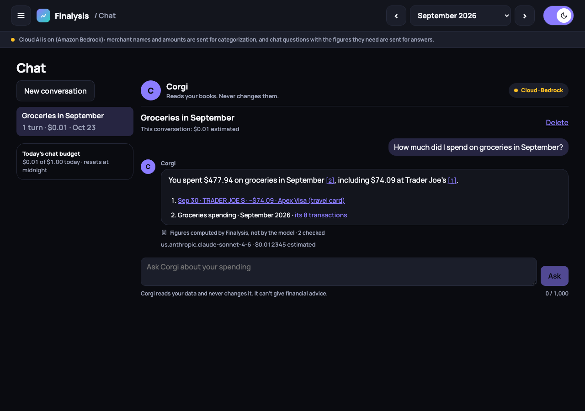

Questions about your own data, answered by **Corgi** (see [Chat](#chat)). Citations link to the transactions,
totals, alerts and recurring series behind the figures; each answer says how many figures Finalysis checked and what
the turn cost. The left column lists conversations with their cost and today's chat budget. *The screenshot's answer
is the tests' hand-written fixture with cloud AI shown on; the sample-data backend runs with AI off, and no model was
called for it.*

### Goals and Settings

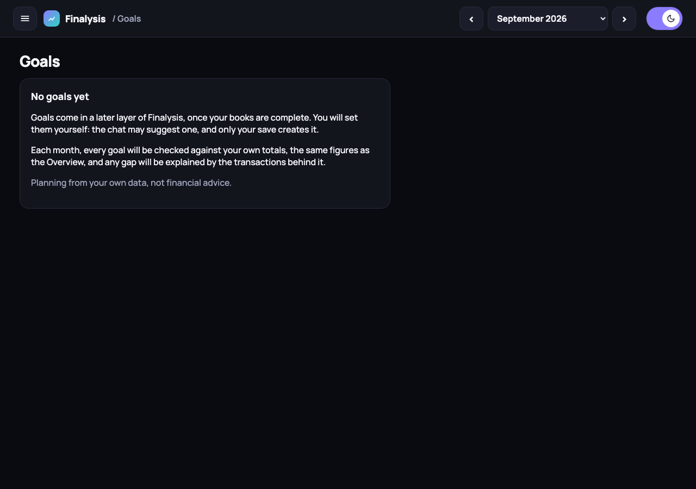

Goals is the tab's shell (GOAL-06): its empty state; goal records come with Layer 2. Settings is read-only: Corgi's
mode and the model behind each role, today's and this month's chat spend, and the cost limits.

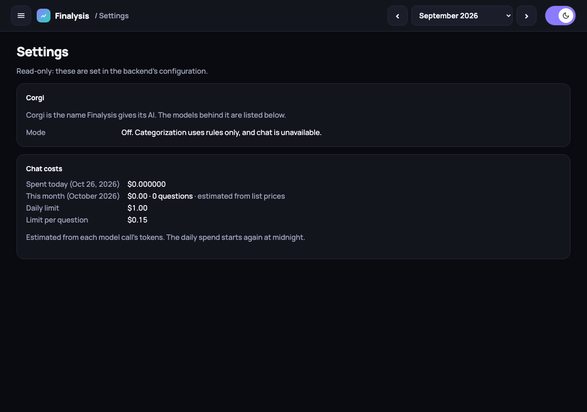

### Phone access (UI-08)

Not yet. The backend binds to `127.0.0.1` (`server.address`) and the database too, so nothing on the network can reach
your data. A phone needs login and HTTPS first (Phase 8). The layout is ready: every screen is checked at 375 px with
44 px touch targets.

## Data model

Postgres 17 with pgvector. The schema is owned by Flyway (`backend/src/main/resources/db/migration`).
Hibernate only validates it. Requirements: DAT-01 to DAT-08 in [docs/requirements.md](docs/requirements.md).
Columns and tables added after V1 are marked with the migration that added them (V5 to V24).

```mermaid
erDiagram
    account ||--o{ statement : has
    account ||--o{ txn : has
    account ||--o| csv_mapping : "reads CSV with"
    statement ||--o{ txn : contains
    category ||--o{ txn : categorizes
    category ||--o{ categorization_rule : "assigned by"
    category |o--o{ category : parent
    txn |o--o| transfer_link : "out side"
    txn |o--o| transfer_link : "in side"
    txn ||--o{ transfer_rejection : "rejected pair"
    account ||--o{ unparsed_upload : "unrecognized PDFs"
    statement |o--o{ unparsed_upload : "resolved by"
    txn }o..o| merchant_embedding : "cleaned merchant (no FK)"
    txn }o..o| search_embedding : "merchant or category (no FK)"
    chat_conversation ||--o{ chat_turn : has
    chat_turn ||--o{ chat_tool_call : ran

    account {
        bigint id PK
        text name
        text institution
        text type "CHECKING, SAVINGS, CREDIT_CARD"
        char4 last_four
        date closed_on "V19: last open day, null while open"
    }
    statement {
        bigint id PK
        bigint account_id FK
        date period_start
        date period_end
        numeric opening_balance
        numeric closing_balance
        text status "IMPORTED, NEEDS_REVIEW, RECONCILED"
        text balance_check "V7: PASSED, FAILED, UNVERIFIED"
        int parsed_count "V7: rows in the file"
        numeric parsed_amount_total "V7: their sum"
        text parser "V5: ofx, csv, ..."
        jsonb import_warnings "V5"
        text source_file_name
        text file_hash UK
        jsonb section_totals
        timestamptz imported_at
        timestamptz reviewed_at "V10: user accepted NEEDS_REVIEW"
    }
    csv_mapping {
        bigint account_id PK,FK "V6"
        text delimiter
        text encoding
        boolean header_row
        int skip_rows
        text header_signature
        text date_column
        text date_format
        text post_date_column
        text_array description_columns
        text amount_mode "SINGLE, DEBIT_CREDIT"
        text amount_column
        text debit_column
        text credit_column
        text sign "AS_IS, INVERTED"
        text balance_column
        text check_number_column
        timestamptz used_at "locks fingerprint fields"
        timestamptz updated_at
    }
    category {
        bigint id PK
        text name UK
        text kind "EXPENSE, INCOME, TRANSFER"
        bigint parent_id FK
    }
    txn {
        bigint id PK
        bigint account_id FK
        bigint statement_id FK
        date txn_date
        date post_date
        text raw_description
        text merchant
        numeric amount "negative = money out"
        text source_section
        varchar check_number
        text counterparty "local only"
        text external_id "V5: OFX FITID"
        text printed_amount "V5: as printed"
        bigint category_id FK
        text category_source "RULE, AI, USER"
        boolean is_transfer "on a transfer link (V9 trigger)"
        boolean transfer_excluded "V9: user said not a transfer"
        text fingerprint UK
        int source_line_number
        text source_line_text
    }
    categorization_rule {
        bigint id PK
        text pattern
        text match_type "CONTAINS, REGEX"
        bigint category_id FK
        text source "SEED, USER_CORRECTION"
        int priority
        boolean active
    }
    transfer_link {
        bigint id PK
        bigint out_txn_id FK,UK "V9: null for a one-sided in"
        bigint in_txn_id FK,UK "null for a one-sided out"
        text method "AUTO, USER"
        text status "MATCHED, UNMATCHED"
        timestamptz confirmed_at "V9: user looked at it"
        timestamptz created_at
    }
    transfer_rejection {
        bigint out_txn_id PK,FK "V9"
        bigint in_txn_id PK,FK
        timestamptz created_at
    }
    unparsed_upload {
        bigint id PK "V8"
        bigint account_id FK
        text file_sha256
        text file_name
        text reason "UNRECOGNIZED_LAYOUT, NO_TEXT_LAYER"
        timestamptz created_at
        timestamptz resolved_at
        text resolution "V11: RESOLVED, DISMISSED"
        bigint resolved_statement_id FK
    }
    merchant_embedding {
        text merchant PK
        vector1024 embedding
        text model
    }
    alert_dismissal {
        text alert_key PK "V20: no FK, survives a re-import"
        text alert_type
        text note
        timestamptz dismissed_at
    }
    search_embedding {
        text kind PK "V23: MERCHANT, CATEGORY"
        text subject PK
        text model PK
        text input_sha256
        vector1024 embedding
    }
    chat_conversation {
        bigint id PK "V21"
        text title "first question, 80 characters"
        text summary "older turns, figures stripped"
        int summary_through
        timestamptz updated_at
    }
    chat_turn {
        bigint id PK "V21"
        bigint conversation_id FK
        int seq
        text question "as typed"
        text outbound_question "as sent"
        text answer "as shown"
        text answer_source "MODEL, FALLBACK, ERROR"
        text grounding_status
        text limit_hit
        jsonb citations
        numeric estimated_cost
        int cache_read_tokens "V24"
        int cache_write_tokens "V24"
    }
    chat_tool_call {
        bigint id PK "V21"
        bigint turn_id FK
        text tool
        jsonb arguments
        text status
    }
    chat_usage {
        bigint id PK "V22: counts only, no FK"
        text kind "TURN, CONVERSATION_SUMMARY, MONTHLY_SUMMARY"
        text model
        numeric estimated_cost
        int cache_read_tokens "V24"
        int cache_write_tokens "V24"
    }
```

| Table | Purpose |
|---|---|
| `account` | A checking, savings, or credit card account. Only the last four digits of the account number are stored. |
| `statement` | One imported statement file for one account and period, with its opening and closing balances, printed section totals, status and balance-check outcome, and the parsed row count and total (duplicates included) that reconciliation uses. A file hash blocks importing the same file twice; a re-imported period is deduplicated row by row. `parser` records which parser read the file. |
| `category` | Seeded spending and income categories, each with a kind. `TRANSFER` covers all movement between the user's own accounts. `spending_offset` (V18, set for Refunds & Rebates only) makes analytics count the category in spending, as money back, instead of as income. |
| `txn` | One statement row: dates, raw description, cleaned merchant, signed amount, category and who set it, and where it came from in the source file. |
| `csv_mapping` | How to read one account's CSV exports: delimiter, encoding, table start, which columns hold the date, description, amount (single or debit/credit), balance and check number, and the sign. `used_at` is set by the first import that uses it, which locks the fields that feed fingerprints. |
| `categorization_rule` | Merchant pattern → category rules. Rules run before any AI, and user corrections become new rules. |
| `transfer_link` | Pairs the outgoing and incoming side of a transfer between the user's own accounts, such as a card payment, or marks one side alone as a transfer to or from an account that isn't in the app. See [Transfers](#transfers-and-the-review-queue). |
| `transfer_rejection` | A pair the user unlinked or dismissed: detection never proposes it again. |
| `unparsed_upload` | A PDF that no layout parser recognized: account, file hash and name, reason, and how it was resolved. No bytes or text are kept. |
| `merchant_embedding` | One embedding per cleaned merchant name, used to find similar merchants for categorization. |
| `search_embedding` | The chat search index: one embedding per merchant (its redacted name plus its category name) and per category name, per embedding model. |
| `chat_conversation` | One chat conversation: a title (the first question), and the summary of older turns with every figure stripped. Deleted by the user or after 90 idle days. |
| `chat_turn` | One question as typed and as sent, the answer as shown, its grounding, citations, limits and usage. Tool results are never stored. |
| `chat_tool_call` | The tool calls of a turn: tool name, arguments, status, row count and time. |
| `chat_usage` | The usage ledger: tokens and estimated cost of every chat turn and summary, counts only. The daily cost cap sums it, so deleting a conversation doesn't reset it. |
| `alert_dismissal` | Alerts the user dismissed, by stable alert key, with an optional note. Alerts themselves are computed on demand and never stored. See [Alerts](#alerts). |

### Design decisions

- **`txn_date` vs `post_date`.** `post_date` is the date printed in the statement's date column.
  `txn_date` is when the purchase happened: a date embedded in the description
  (`CHECKCARD 0704 …`) if there is one, otherwise the posting date. Analytics group by `txn_date`.
- **Two-level reconciliation.** Each row records the statement section it was printed in
  (`source_section`: deposit, withdrawal, check, fee, …), and `statement.section_totals` stores the
  printed total per section. Import first checks each section's rows against its printed total,
  then checks opening balance + all rows = closing balance. A missing row shows up in a specific
  section, not just as an overall mismatch.
- **Fingerprint.** `txn.fingerprint` is a SHA-256 of raw printed values only (account, printed
  date, amount, description, section) plus an occurrence number. Re-importing a statement
  reproduces the same fingerprints, so its rows are skipped, while two genuinely identical charges
  get occurrence 1 and 2 and are both kept. The OFX transaction id (`FITID`) is deliberately not
  hashed, because some institutions reissue ids on later downloads; it is kept in
  `txn.external_id` to flag possible duplicates. Derived values (merchant, category, embedded
  `txn_date`, counterparty) are excluded because they change as parsing improves. If they were
  hashed, a better parser would re-insert every old row.
- **Source tracing.** `source_line_number` and `source_line_text` record where each row came from
  in the original file, so any total can be traced back to statement lines.
- **`counterparty` is local only.** Person-to-person payees and payers (e.g. Zelle) are stored for
  the user's own use and are never sent to a cloud model.
- **`transfer_link`.** A MATCHED link has both sides; an UNMATCHED link has exactly one, either
  side (V9), for a transfer to or from an account that isn't in the app. CHECK constraints tie
  `MATCHED` to both sides and require a USER link to be confirmed. The unique constraints stop a txn
  from appearing twice on the same side, and the V3 trigger also stops it from being the out side
  of one link and the in side of another, so a txn belongs to at most one link.
- **`is_transfer` is derived.** It is true exactly when the txn is on a link, either side, whatever
  the link's status. A V9 trigger keeps it in step on every insert, update and delete, cascades
  included, so a statement delete can't leave a stale flag. Nothing else writes it; JPA maps it
  read-only. A CHECK makes `is_transfer AND transfer_excluded` impossible.
- **`unparsed_upload.resolution`** (V11) records how an upload left the review queue: RESOLVED
  (uploaded again and imported) or DISMISSED. It is null exactly while `resolved_at` is null, and only
  a RESOLVED upload has a statement. Deleting that statement later nulls `resolved_statement_id`
  but keeps RESOLVED.
- **`merchant_embedding`.** One row per cleaned merchant name, not per transaction. Merchants repeat,
  so each is embedded once. `vector(1024)` is a dimension that both the cloud and the local
  embedding models produce, so both share one schema. A cosine HNSW index serves nearest-neighbour
  search. The `model` column records which model produced each vector, so rows can be re-embedded
  when the model changes.
- **One account per institution, type and last four** (V12). Institution is compared ignoring
  case and surrounding spaces; the name is free, so two accounts may share one and a rename never
  conflicts. The API inserts with `ON CONFLICT DO NOTHING` on the unique index and then looks up the
  existing id, so the index, not a prior read, decides, and concurrent creates give one 201 and one
  `409 account-exists`.
- **Categories are bank-agnostic.** They describe the kind of spending, not any institution's own
  category labels, so one set applies to every account.

### Migrations

| Version | Purpose |
|---|---|
| V1 `init` | Initial schema: all seven tables, constraints, indexes, and the pgvector extension. |
| V2 `seed_categories` | Seeds the categories: the sample-data answer key's categories plus general-purpose ones. |
| V3 `transfer_link_txn_once` | Trigger ensuring a txn belongs to at most one transfer link, on either side. |
| V4 `account_name_lengths` | CHECK constraints limiting account name and institution to 1–100 characters. |
| V5 `statement_import` | `txn.external_id` and `printed_amount`, `statement.parser` and `import_warnings`; drops the unique (account, period) constraint so periods can be re-imported. |
| V6 `csv_mapping` | `csv_mapping`: one CSV column mapping per account, with CHECK constraints for its enums, amount columns and column indexes. |
| V7 `statement_reconciliation` | `statement.balance_check` (PASSED, FAILED, UNVERIFIED), `parsed_count` and `parsed_amount_total`, for reconciliation and late-arrival re-checks. |
| V8 `unparsed_upload` | `unparsed_upload`: PDFs no parser recognized, at most one open row per account and file; a resolving statement's deletion sets its id to null. |
| V9 `transfer_detection` | `transfer_link` sides both nullable (never both null; MATCHED means both), `confirmed_at`, USER implies confirmed; `txn.transfer_excluded`; `transfer_rejection`; the trigger that keeps `txn.is_transfer` equal to "on a link". |
| V10 `statement_review` | `statement.reviewed_at`, allowed only on NEEDS_REVIEW statements. |
| V11 `unparsed_upload_resolution` | `unparsed_upload.resolution` (RESOLVED, DISMISSED), tied to `resolved_at`, backfilled from V8's rule. |
| V12 `account_unique` | Unique index `uq_account_identity` on (lower(btrim(institution)), type, last_four). Fails, naming the account ids, if duplicates already exist. |
| V13 `merchant_cleaning` | `ix_txn_merchant` on `txn (merchant)`; `app_setting`, a small key-value table whose first use is the merchant-cleaning rules' fingerprint, so a changed rules file re-cleans every txn at startup. |
| V14 `categorization_rules` | `categorization_rule.field` (MERCHANT, DESCRIPTION), `direction` (ANY, OUT, IN) and `updated_at`; match types EXACT, PREFIX, CONTAINS, REGEX; source USER; priority 0–1000; patterns 1–200 characters, upper case unless REGEX; one active user rule per field, match type, pattern and direction. `txn.category_rule_id` (only on a RULE category) and `categorized_at`. |
| V15 `seed_categorization_rules` | The 95 seeded rules: national brands, payment services and generic category words, never a sample-data name. |
| V16 `ai_categorization` | AI provenance on `txn` (`category_model`, `category_confidence` 0–1, `category_prompt_version`, only on an AI category) and `ai_review_reason` (LOW_CONFIDENCE, INVALID_ANSWER) with `ai_review_at`, only on an uncategorized txn; `ix_txn_ai_review`. |
| V17 `merchant_embedding_by_model` | Replaces V1's `merchant_embedding`: one vector per merchant and model, with `dimensions` (1024) and the SHA-256 of the redacted text embedded; HNSW cosine index. |
| V18 `analytics` | `category.spending_offset`, set for Refunds & Rebates; `ix_txn_date` on `txn (txn_date)` for month-range totals across accounts. |
| V19 `account_closed_on` | `account.closed_on`: the last day an account was open; coverage expects no statement after it. |
| V20 `alert_dismissal` | `alert_dismissal`: dismissed alerts by key, with CHECK constraints on the key format, the alert type and a 1–200 character note. |
| V21 `chat` | `chat_conversation`, `chat_turn` and `chat_tool_call` (turns and tool calls cascade with their conversation), with CHECK constraints on question length (1–1,000), answer source, grounding status, limits and tool-call status. Written only by `ChatConversationStore`. |
| V22 `chat_usage` | `chat_usage`: one row per chat turn, conversation summary and monthly summary with its tokens and estimated cost, no conversation id or text; backfilled from existing turns. The daily cost cap sums it. |
| V23 `search_embedding` | `search_embedding`: chat's search index, one 1024-dimension vector per merchant document (redacted text plus category) or category name and embedding model, with the SHA-256 of what was embedded; HNSW cosine index. Categorization's `merchant_embedding` is unchanged. |
| V24 `chat_cache_tokens` | `cache_read_tokens` and `cache_write_tokens` on `chat_turn` and `chat_usage`, for prompt caching; null on older rows. |

Applied migrations are never edited. Every schema change is a new migration.

> **V12 on an existing dev database:** if the backend fails to start with `V12: duplicate accounts
> (same institution, type and last four), account ids: …`, the dev database holds accounts created
> twice before V12. V12 never merges or deletes them, since statements may hang off either copy.
> Reset the dev database with `scripts/reset-dev-db.sh` (this deletes all local data) and start the
> backend again.

## API

| Method | Path | Purpose | Success | Problem types (besides 400/404) |
|---|---|---|---|---|
| `GET` | `/api/status` | Backend health, shown by the frontend, and the AI mode (`ai.mode`: `OFF`, or `CLOUD` with provider and models) for the cloud banner | 200 | — |
| `GET` | `/actuator/health` | Liveness for tooling: `{"status": "UP"}`, no details | 200 | — |
| `POST` | `/api/accounts` | Register an account (DAT-01); one per institution, type and last four | 201, `Location` | `account-exists` |
| `GET` | `/api/accounts` | List accounts, sorted by name | 200 | — |
| `GET` | `/api/accounts/{id}` | Get one account | 200 | — |
| `PATCH` | `/api/accounts/{id}` | Rename an account (only `name`) | 200 | — |
| `GET` | `/api/categories` | List the seeded categories (DAT-02) | 200 | — |
| `GET` | `/api/accounts/{id}/csv-mapping` | Get the account's CSV mapping; 404 when it has none | 200 | — |
| `PUT` | `/api/accounts/{id}/csv-mapping` | Create or replace the CSV mapping; `?confirmFingerprintChange=true` accepts a change to a locked field. See [CSV mappings](#csv-mappings) | 201 created, 200 replaced | `mapping-locked` |
| `POST` | `/api/accounts/{id}/imports/preview` | Read a file as an import would and write nothing; CSV gets a suggested mapping. See [Preview](#preview) | 200 | `payload-too-large`, `unsupported-format`, `ambiguous-format`, `parse-error`, `account-mismatch`, `unsupported-currency` |
| `POST` | `/api/accounts/{id}/imports` | Import a statement file (multipart `file`; optional `periodStart`, `periodEnd`, `openingBalance`, `closingBalance`). See [Importing statements](#importing-statements) | 201, `Location`; 202 + `Location` for an unrecognized PDF | all import types: see the [error catalogue](#error-catalogue) |
| `GET` | `/api/accounts/{id}/statements` | List the account's statements, newest period first; `?status=IMPORTED\|RECONCILED\|NEEDS_REVIEW` filters | 200 | — |
| `GET` | `/api/statements/{id}` | Get one imported statement with its warnings and `reviewedAt` | 200 | — |
| `POST` | `/api/statements/{id}/review` | Accept a NEEDS_REVIEW statement: sets `reviewedAt`, keeps status and warnings | 200 | `not-reviewable` |
| `DELETE` | `/api/statements/{id}` | Delete a statement of any status with its rows; their transfer links go too, then detection re-runs | 200 `{statementId, transactionsDeleted, transferLinksRemoved}` | — |
| `GET` | `/api/unparsed-uploads/{id}` | One unparsed upload with its `state` (OPEN, RESOLVED, DISMISSED) | 200 | — |
| `POST` | `/api/unparsed-uploads/{id}/dismiss` | Dismiss an open unparsed upload | 200 | `already-resolved` |
| `GET` | `/api/transfers` | List transfer links, newest first; `?status=MATCHED\|UNMATCHED`, `?confirmed=true\|false`, `?accountId=` filter | 200 | — |
| `GET` | `/api/transfers/{id}` | One link with both sides | 200 | — |
| `POST` | `/api/transfers` | `{outTxnId, inTxnId}` links two txns by hand; one of them marks a one-sided transfer | 201, `Location` | `transfer-invalid`, `transfer-conflict` |
| `POST` | `/api/transfers/{id}/confirm` | Mark a link as looked at (idempotent) | 200 | — |
| `DELETE` | `/api/transfers/{id}` | Unlink; a MATCHED pair is remembered as rejected | 204 | — |
| `POST` | `/api/transfers/join` | `{outLinkId, inLinkId}`: join two one-sided links into one confirmed link | 201, `Location` | `transfer-invalid`, `transfer-conflict` |
| `POST` | `/api/transfers/join/dismiss` | `{outLinkId, inLinkId}`: dismiss that possible match (records the pair as rejected) | 204 | `transfer-invalid`, `transfer-conflict` |
| `POST` | `/api/transfers/detect` | Run detection now | 200 `{linksCreated, unmatchedCompleted, groupsForReview}` | — |
| `POST` | `/api/transactions/{id}/not-transfer` | Mark a txn not a transfer: removes its link (rejecting a MATCHED pair), excludes it from detection, and clears a rule or AI category of Transfer kind (a category you set stays) | 200 `{txnId, transferExcluded, removedLinkId}` | — |
| `DELETE` | `/api/transactions/{id}/not-transfer` | Undo it; the next detection run may link the txn, and the next rules pass may categorize it | 204 | — |
| `GET` | `/api/review-queue` | Everything waiting for the user, across accounts; `?kind=`, `?accountId=` filter. See [Review queue](#review-queue) | 200 | — |
| `GET` | `/api/transactions` | List txns, newest first, paged (`?page=`, `?size=` up to 200); filters `accountId`, `statementId`, `categoryId`, `uncategorized`, `source=RULE\|AI\|USER`, `isTransfer`, `from`, `to`, `merchant` | 200 `{items, page, size, total}` | — |
| `GET` | `/api/transactions/{id}` | One txn: merchant, category (`id`, `name`, `kind`), `categorySource`, the rule behind a RULE category, the model and confidence behind an AI one, `aiReviewReason`, `isTransfer`, `transferExcluded`, its `statement` (`{id, periodStart, periodEnd}`) and `sourceLine` (`{number, text}`) | 200 | — |
| `PUT` | `/api/transactions/{id}/category` | `{categoryId, applyToMerchant}`: set your category (USER). By default also creates or updates a correction rule for the merchant and direction, so its other txns follow (CAT-04) | 200 `{txn, ruleId, ruleAction, otherTxnsUpdated, otherTxnsKeptUser, otherTxnsKeptOtherRule}` | `category-invalid` |
| `DELETE` | `/api/transactions/{id}/category` | Clear your category; the rules run for the txn. `?removeRule=true` also deletes the merchant's correction rule and re-runs its rules | 200 `{txn, ruleId, ruleAction, otherTxnsUpdated}` | — |
| `GET` | `/api/categorization/rules` | Rules in winning order; `?source=SEED\|USER\|USER_CORRECTION`, `?active=`, `?categoryId=` filter | 200 | — |
| `GET` | `/api/categorization/rules/{id}` | One rule | 200 | — |
| `POST` | `/api/categorization/rules` | Create a USER rule, applied at once; `matchCount`, `winCount` and `shadowedBy` say what it does | 201, `Location` | `rule-invalid`, `category-invalid`, `rule-exists` |
| `PATCH` | `/api/categorization/rules/{id}` | Change a user rule; a seeded rule accepts only `active` | 200 | `rule-invalid`, `category-invalid`, `rule-exists`, `rule-seeded` |
| `DELETE` | `/api/categorization/rules/{id}` | Delete a user rule; its txns are re-evaluated | 204 | `rule-seeded` |
| `POST` | `/api/categorization/run` | Run every stage now. `?reclean=true` re-cleans merchants first, `?ai=false` skips the AI, `?force=true` asks the AI again for txns it answered or left for review | 200: rules-stage counts, an `ai` block (`status` `OFF` when AI is off), the chat search index refresh (`searchIndex`) and a `summary` counted in Java: `{categorized, toReview, heldBack, modelCalls, merchantsIndexed}` | — |
| `PUT` | `/api/accounts/{id}/closure` | `{closedOn}`: the account's last open day; coverage expects no statement after it (idempotent) | 200 | — |
| `DELETE` | `/api/accounts/{id}/closure` | Reopen the account (idempotent) | 200 | — |
| `GET` | `/api/analytics/months` | Month totals with coverage and data quality; `?from=&to=` (`yyyy-MM`), `?accountId=`. See [Analytics](#analytics) | 200 | — |
| `GET` | `/api/analytics/categories` | Money per bucket and category per month; `?from=&to=&accountId=&categoryId=&uncategorized=` | 200 | — |
| `GET` | `/api/analytics/accounts` | Each account's month totals; `?from=&to=` | 200 | — |
| `GET` | `/api/analytics/merchants` | Top merchants by `spent`, with the rest summed; `?from=&to=&accountId=&categoryId=&limit=` (10, at most 50) | 200 | — |
| `GET` | `/api/analytics/trends` | Month over month, trailing 3 and 6 complete months, year over year; `?month=&accountId=&categoryId=` | 200 | — |
| `GET` | `/api/analytics/transactions` | The txns behind any total, newest first, paged (`?size=` up to 200); `?month=` or `?from=&to=`, `bucket`, `measure=SPENT\|RECEIVED`, `accountId`, `categoryId`, `merchant`, `noMerchant` | 200 | — |
| `GET` | `/api/analytics/coverage` | Covered spans, gaps and flagged statements per account | 200 | — |
| `GET` | `/api/analytics/recurring` | Monthly recurring charges; `?status=ACTIVE\|ENDED\|ALL&accountId=&limit=` (50, at most 100) | 200 | — |
| `GET` | `/api/dashboard` | The Overview in one read: `?month=` (default the latest); totals, changes from last month, six months of cash flow, spending slices (Other and Uncategorized included), newest alerts, recurring charges. Every figure equals its own endpoint's | 200 | — |
| `GET` | `/api/dashboard/details` | One Overview figure's panel: `?month=` with `categoryId`, `uncategorized=true` or `line=INCOME`; total, share, trailing average, six-month trend, top merchants, and the drill-down whose rows add up to it | 200 | — |
| `GET` | `/api/alerts` | Alerts with their basis, newest month first; `?from=&to=` (default the last 3 months), `type`, `accountId`, `includeDismissed`, `limit` (at most 100) | 200 `{items, counts, truncated, …}` | — |
| `GET` | `/api/alerts/{key}` | One alert, computed for its key's month | 200 | — |
| `PUT` | `/api/alerts/{key}/dismissal` | `{note?}`: dismiss a current alert (idempotent; the first time is kept, the note replaced) | 200 with the alert | — |
| `DELETE` | `/api/alerts/{key}/dismissal` | Undo a dismissal (idempotent) | 204 | — |
| `POST` | `/api/chat/conversations` | Start an empty conversation. See [Chat](#chat) | 201 `{id, createdAt}`, `Location` | — |
| `GET` | `/api/chat/conversations` | Conversations, newest activity first; `?page=&size=` (default 20) | 200 `{items: [{id, title, turns, totalCost, updatedAt}], page, size, totalPages}`; `totalCost` is the sum of its turns' estimated costs, null when none has a price | — |
| `GET` | `/api/chat/conversations/{id}` | One conversation with its turns (question, answer, grounding, citations re-resolved, limit, usage) | 200 `{id, title, totalCost, createdAt, updatedAt, turns}` | — |
| `DELETE` | `/api/chat/conversations/{id}` | Delete it with its turns and summary | 204 | — |
| `POST` | `/api/chat/conversations/{id}/turns` | `{message}` (1–1,000 characters): ask a question. With AI off, 503 before the conversation is looked up | 200 `{conversationId, turn, answer, answerSource, grounding, citations, dataNotes, tools, usage, limitHit, redactions}` | `ai-off`, `turn-in-progress`, `chat-budget`, `chat-busy`, `ai-unavailable` |
| `GET` | `/api/chat/usage` | Today's estimated chat spend (the figure the daily cap checks), the caps, the next reset, and this month's spend and question count | 200 `{day, spentToday, maxTurnCost, maxDailyCost, resetsAt, month, spentThisMonth, questionsThisMonth}` | — |
| `POST` | `/api/chat/summaries` | `{month?}` (`yyyy-MM`, default the latest complete month): the plain-English monthly summary (ANA-05); a Java template with AI off | 200 `{month, source: MODEL\|TEMPLATE, text, grounding, citations, dataNotes, usage}` | `chat-budget`, `ai-unavailable` |
| `POST` | `/api/chat/search-index/refresh` | Embed merchants and categories missing from the chat search index (capped per run) | 200 `{status, merchants, cached, embedded, calls, callsWithoutUsage, inputTokens, remaining}`; `status: OFF` with AI off | — |

- **Money is a string.** Every money field in a response is a JSON string with exactly two
  decimals (`"closingBalance": "4066.58"`), and money in a request must be such a string; a JSON
  number gets a 400 naming the field. JavaScript reads JSON numbers as binary floating point, which
  can lose cents.
- **Descriptions in responses.** Transfer and review-queue responses include each txn's
  `rawDescription`, because the user needs it to decide. It's the user's own data on a local API;
  logs and problem responses still never carry descriptions or amounts (SEC-10).
- **Strict bodies.** Request bodies reject unknown fields. `PATCH /api/accounts/{id}` accepts only
  `name`, so trying to change the type or last four digits returns a 400 that names the field.
  Accounts cannot be deleted.
- **Errors** are RFC 9457 problem details (`application/problem+json`). Validation errors add an
  `errors` list of `{field, message}`:

  ```json
  {
    "title": "Invalid request",
    "status": 400,
    "detail": "One or more fields are invalid",
    "instance": "/api/accounts",
    "errors": [
      { "field": "lastFour", "message": "must be exactly 4 digits" },
      { "field": "name", "message": "must not be blank" }
    ]
  }
  ```

### Error catalogue

Typed problems have a `type` of `urn:finalysis:problem:<name>`; the others use the default
`about:blank`. No problem response quotes file contents, descriptions, file names or account
numbers (SEC-10). Constraint names, SQL and stack traces are logged on the server and never
returned.

| Status | `type` | Meaning | What to do |
|---|---|---|---|
| 400 | — | Invalid field, unknown field (`"is not allowed"`), bad enum value (lists the allowed values), a JSON number for money, a balance form field with more than two decimals, an inverted period. `errors[]` names each field | Fix the named fields and resend |
| 400 | — | Malformed JSON, or a non-numeric id | Send valid JSON and numeric ids |
| 404 | — | Unknown id (`Account 42 not found`), or an account without a CSV mapping on `GET …/csv-mapping` | Check the id with `GET /api/accounts`; save a mapping first |
| 405, 415 | — | Wrong HTTP method, or a JSON/multipart body sent where the other is expected (Spring's own errors, same format) | Use the method and body type from the API table |
| 409 | — | A database constraint was violated; generic `detail` | Should not happen through the API; check the server log and report it |
| 409 | `account-exists` | `POST /api/accounts` for an account that exists: same institution (ignoring case and surrounding spaces), type and last four. `accountId` names it; no other account data is returned | Use that account (`GET /api/accounts/{accountId}`); rename it if the name is what should differ |
| 409 | `mapping-locked` | A used CSV mapping's fingerprint fields (sign, description columns, printed-date column) would change; `fields[]` lists them | If the change is intended, resend with `?confirmFingerprintChange=true`; overlapping re-imports will then add rows again and need review |
| 413 | `payload-too-large` | File over 10 MB | Export a shorter date range |
| 415 | `unsupported-format` | Disallowed extension, empty, ZIP/XLSX, saved web page, binary or invalid text, a PDF not named `.pdf` (or the reverse), or no parser recognizes the content | Download the statement as OFX, QFX or CSV |
| 422 | `pdf-encrypted` | The PDF needs a password to open | Download an unprotected copy, or use OFX/QFX/CSV |
| 422 | `pdf-too-complex` | The PDF is over the limits on pages, decoded size, glyphs, form nesting or extraction time | Download a shorter period, or use OFX/QFX/CSV |
| 409 | `already-imported` | This exact file was imported before; `statementId` names it | Nothing to do: open that statement |
| 422 | `parse-error` | A row or the file structure can't be read; `line` (and the column position for CSV) when known. Nothing was written | Check that the file wasn't edited or cut short and download it again. For CSV, check the mapping's `dateFormat`, amount columns and `skipRows` against the [preview](#preview); footer rows are a [known limitation](#known-limitations) |
| 422 | `account-mismatch` | The file's account type or last four digits differ from the account's | Upload it to the account it belongs to |
| 422 | `unsupported-currency` | The statement isn't in USD | Not supported yet |
| 422 | `mapping-required` | A CSV file for an account without a CSV mapping; `detail` points to the preview | Preview the file, check `suggestedMapping.mapping`, `PUT` it, import again |
| 422 | `mapping-mismatch` | The CSV file's columns differ from the mapping's; `preview` holds its headers, mapping status and a suggested mapping, no rows | Check it's the right account. If the bank changed its export, `PUT` the suggested mapping (confirm if locked fields change) |
| 409 | `mapping-changed` | The CSV mapping was saved while the file was being read; nothing was written | Import again |
| 422 | `ambiguous-format` | More than one parser claims the file: a detection bug, never guessed | Report it (with the file's format, not the file) |
| 409 | `not-reviewable` | `POST /api/statements/{id}/review` on a statement that isn't NEEDS_REVIEW | Nothing to review; only NEEDS_REVIEW statements are |
| 409 | `already-resolved` | Dismissing an unparsed upload that is already RESOLVED or DISMISSED; `detail` names the state | Nothing to do |
| 422 | `transfer-invalid` | A transfer action breaks a link rule: same account, wrong signs (out must be negative, in positive), amounts not equal and opposite, or no side given. `detail` names the rule, never an amount | Pick the right pair; amounts must match to the cent |
| 409 | `transfer-conflict` | A txn is already on a link (`linkId` names it), or a join names a link that is no longer one-sided with that side | Unlink first (`DELETE /api/transfers/{linkId}`); nothing is replaced silently. For a join, re-read the review queue |
| 422 | `rule-invalid` | A rule pattern is empty or over 200 characters once normalized, or a REGEX that doesn't compile. `field` names it; the pattern is never echoed | Fix the pattern |
| 422 | `category-invalid` | A correction or a rule names a category that doesn't exist | Pick one from `GET /api/categories` |
| 409 | `rule-exists` | An active user rule with the same field, match type, pattern and direction exists; `ruleId` names it | Change that rule instead |
| 409 | `rule-seeded` | Deleting a seeded rule, or changing anything on it but `active` | Deactivate it (`PATCH {"active": false}`), or write a user rule, which outranks every seed |
| 503 | `ai-off` | A chat turn with no AI profile. Checked before the conversation is looked up, so an unknown id is also 503 with AI off (404 with AI on). Nothing is stored, no call is made | Start the backend with `SPRING_PROFILES_ACTIVE=aws` |
| 409 | `turn-in-progress` | Another question in the same conversation is still being answered | Wait for it, then ask again |
| 429 | `chat-budget` | The day's estimated chat cost reached `max-daily-cost`; `resetsAt` says when (local midnight) | Wait, or raise the cap |
| 429 | `chat-busy` | Too many questions at once across conversations, for longer than the wait | Try again in a moment |
| 502 | `ai-unavailable` | The model call failed after the SDK's retries; a failed turn is stored with its error class only | Try again later |
| 500 | — | Unexpected error; generic `detail` | Check the server log (it holds no statement data) and report it |

## Importing statements

Upload one statement file per request to the account it belongs to. Supported: OFX
1.x/2.x, QFX and CSV. **PDF support is partial:** a PDF is accepted and checked, but none is
imported; the PDF parsers ([Phase 3b](docs/plans/phase-3b.md), paused) and OCR are later,
aspirational enhancements ([roadmap](docs/plans/roadmap.md#later-enhancements)), not part of the POC. A layout no parser recognizes becomes an
**unparsed upload** (202 Accepted, `Location: /api/unparsed-uploads/{id}`) that waits in the
[review queue](#review-queue), and the BoA checking layout, recognized but not yet readable, gets
`422 parse-error`. Uploading the same PDF again re-runs detection instead of `409 already-imported`. Optional form fields: `periodStart` and
`periodEnd` (ISO dates) replace the file's period; `openingBalance` and `closingBalance` are the
statement's balances as printed on paper, for files that don't carry them (card CSV exports), and
are checked against the rows (see [Reconciliation](#reconciliation)). If the file prints a
balance and the request disagrees, the file's value is kept and the check fails. Balances are
plain decimal text such as `1234.56`: at most two decimals, no exponent or thousands separator.

### Pipeline

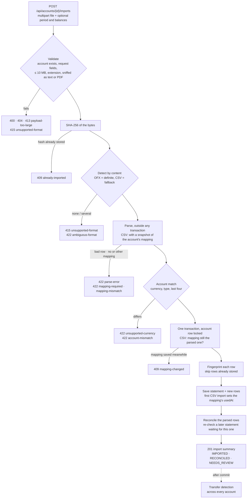

1. **Validate.** The account must exist and the request fields be well formed. At most 10 MB;
   the file name must end in `.ofx`, `.qfx`, `.csv`, `.txt` or `.pdf`; the bytes must be UTF-8 or
   windows-1252 text, or a PDF named `.pdf` (ZIP/XLSX, web pages and binary data are refused). The client's
   content type is ignored. Uploads are held in memory and discarded after parsing; only a
   SHA-256 hash, the file name and each row's source line are kept.
2. **Hash.** The same file again (same hash) is `409 already-imported` with the existing
   `statementId`.
3. **Detect and parse** by content, outside any database transaction. Any unreadable row fails
   the whole file (`422 parse-error`, with the line number); nothing is written. A CSV file is
   read with a snapshot of the account's mapping, taken just before parsing.
4. **Account match.** The file's currency, last four digits and account type must match the
   account when the file carries them.
5. **Save** in one transaction, with the account row locked so imports to one account run one
   at a time. A CSV import first checks that the mapping is still the one it parsed with (a
   mapping saved in the meantime is `409 mapping-changed`; retry), and the first import that
   uses a mapping sets its `usedAt`. Each row is fingerprinted from its raw values; rows already
   imported for this account are skipped as duplicates, so re-importing a period or an
   overlapping export adds only rows that are new.
6. **Reconcile** the rows parsed from the file against the balances (see
   [Reconciliation](#reconciliation)), then answer with the import summary.
7. **Detect transfers** once the import has committed, in a transaction of its own (see
   [Transfers](#transfers-and-the-review-queue)). A detection failure is logged and never undoes the
   import; the next run catches up. Links are read with `GET /api/transfers`.

### Walkthrough

**OFX or QFX.** Download the statement as OFX/QFX (often called "Quicken" or "Money") and upload
it. Nothing else is needed: the file names the account, the period and the closing balance.

```sh
curl -F file=@sample-data/ofx/northfield-checking_2026-04.ofx http://localhost:8080/api/accounts/1/imports
```

```json
{
  "statementId": 1, "parser": "ofx", "periodStart": "2026-04-01", "periodEnd": "2026-04-30",
  "openingBalance": null, "closingBalance": "4066.58",
  "parsed": 10, "inserted": 10, "duplicates": 0, "status": "IMPORTED", "balanceCheck": "UNVERIFIED",
  "warnings": ["balance unverified: nothing to check the rows against (send openingBalance and closingBalance, or import the previous statement)"]
}
```

The first statement of an account is `IMPORTED`: OFX prints only the closing balance, so there is
nothing to check it against yet. Importing May then checks April's closing + May's rows = May's
closing and gives `RECONCILED`; importing them in the other order works too (late arrival).

**CSV.** CSV exports differ by bank, so the account needs a column mapping, saved once:

```sh
# 1. Preview: how the file will be read, plus a suggested mapping. Writes nothing.
curl -F file=@sample-data/statements/apex-visa_2026-04.csv \
     http://localhost:8080/api/accounts/3/imports/preview > preview.json

# 2. Check suggestedMapping (confidence MATCHED / GUESSED / MISSING, notes), edit if needed, save it.
jq .suggestedMapping.mapping preview.json > mapping.json
curl -X PUT http://localhost:8080/api/accounts/3/csv-mapping \
     -H 'Content-Type: application/json' -d @mapping.json

# 3. Import. A card CSV has no balances, so send the ones printed on the statement.
curl -F file=@sample-data/statements/apex-visa_2026-04.csv \
     -F openingBalance=-842.17 -F closingBalance=-242.32 \
     http://localhost:8080/api/accounts/3/imports
```

Later CSV imports of the account reuse the mapping. Without one, an import is
`422 mapping-required`; a file whose columns differ from the mapping's is
`422 mapping-mismatch`, with the file's headers and a suggested mapping (no data rows). A CSV file
without rows imports as an empty statement when the request gives both `periodStart` and
`periodEnd`. A CSV with a balance column (Northfield) reconciles row by row without sending
balances.

**Statuses.**

| `status` | `balanceCheck` | Meaning | What to do |
|---|---|---|---|
| `RECONCILED` | `PASSED` | At least one balance check ran, all passed, and nothing needs review | Nothing |
| `IMPORTED` | `UNVERIFIED` | Saved, but no check could run (no balances, no adjacent earlier statement); warning `balance unverified: …` | Send `openingBalance` and `closingBalance` next time, or import the previous statement: an OFX statement is re-checked when its predecessor arrives |
| `NEEDS_REVIEW` | any | Saved with the reasons in `warnings` | Read the warnings (`GET /api/statements/{id}`) |

**What lands in review.** `NEEDS_REVIEW` whenever any of these happened; it wins over
`RECONCILED`:

- a balance check failed (see [Reconciliation](#reconciliation));
- the parser warned, for example an OFX `TRNTYPE` that contradicts the amount's sign;
- rows are dated outside the statement period (for example after a `periodEnd` override); they
  are imported anyway, never dropped;
- the period overlaps an earlier statement of the account and the import added rows
  (`period overlaps statement 7`). A re-import that adds nothing only gets the informational
  warning `period overlaps statement 7; no new rows`, which doesn't block `RECONCILED`;
- the account mixes import formats (`account mixes import formats (...)`, see
  [Known limitations](#known-limitations));
- a new row reuses an OFX `FITID` that the account already has under different details. That row
  is inserted anyway, since dropping it could lose a real transaction, and flagged as a possible
  duplicate.

Statements needing review are listed per account by
`GET /api/accounts/{id}/statements?status=NEEDS_REVIEW`, and across accounts by the
[review queue](#review-queue) until you accept them (`POST /api/statements/{id}/review`) or delete
them. Everything is saved either way.
Warnings contain line numbers, counts, ids and balance-check amounts, never descriptions or
account numbers.

**Look-alike rows are kept.** Two purchases with the same amount at the same store on the same
day are both imported, and a refund is its own row. Deduplication only skips a row imported
before: rows are matched by their printed values plus an occurrence number within the statement
(the first identical row is 1, the next 2), so re-uploading a file finds every row again while two
real purchases stay separate.

### Reconciliation

Every import checks the statement's balances against **the rows parsed from the file**, duplicates
included (the rows it inserts skip duplicates, so they can't add up). Java `BigDecimal` does the
arithmetic. Each check runs when its inputs exist:

| Check | When | Rule |
|---|---|---|
| Request balances | both `openingBalance` and `closingBalance` sent | opening + rows = closing |
| Balance column | the CSV mapping has a balance column | each row's balance = the previous balance + its amount. Newest-first files (first date after the last) are checked in reverse. Opening = first balance − first amount, closing = last balance; a balance-only opening row and sent balances must agree with them |
| Continuity | a closing balance without an opening one (OFX `LEDGERBAL`) | the previous statement's closing + rows = closing, when the account's latest earlier statement ends the day before this one starts (or that day). The opening is then the previous closing; it is never derived from `LEDGERBAL` alone |
| Section totals | the file prints totals per section (PDFs, Phase 3b) | each total = the sum of its section's rows; a total for a section without rows must be 0 |
| Printed balances | the file prints both balances (PDFs) | opening + rows = closing |

The outcome is `balanceCheck`: `PASSED` (at least one check ran, all passed → `RECONCILED`),
`FAILED` (→ `NEEDS_REVIEW`) or `UNVERIFIED` (none could run → `IMPORTED` with a
`balance unverified` warning). A failed check adds a warning with the check, the expected amount
(what the arithmetic gives), the actual one (as printed or sent) and the difference:

```
reconciliation failed: continuity: statement 7's closingBalance + rows = closingBalance: expected 8236.77, actual 8246.77, difference 10.00
reconciliation failed: balance column, line 5: expected 2458.91, actual 2459.91, difference 1.00
```

Failing balance-column rows are listed up to 10, then counted. Amounts in warnings go back to
the user only and are never logged.

**Late arrivals.** OFX statements imported out of order still reconcile: when May arrives first,
it is unverified; when April arrives, May's continuity check runs again in the same transaction,
and May becomes `RECONCILED` (with April's closing as its opening) or `NEEDS_REVIEW`. A May that
needs review for another reason stays `NEEDS_REVIEW`.

**Statements.** `GET /api/accounts/{id}/statements` lists an account's statements, newest period
first, with `id`, `parser`, `periodStart`, `periodEnd`, `openingBalance`, `closingBalance`,
`status`, `balanceCheck`, `parsedCount` (rows in the file), `transactionCount` (rows it owns),
`warningCount` and `importedAt`. `?status=NEEDS_REVIEW` (or `IMPORTED`, `RECONCILED`) filters.
`GET /api/statements/{id}` adds the warnings. Both show `reviewedAt` once a NEEDS_REVIEW statement
is accepted; if a late arrival's re-check then adds a warning, `reviewedAt` is cleared and the
statement is back in the review queue.

### Preview

`POST /api/accounts/{id}/imports/preview` takes the same multipart `file` and runs the same upload
checks, detection and parsing as an import, but writes nothing. An OFX/QFX file returns
`format`, `periodStart`, `periodEnd` and `transactionCount`. A CSV file returns how it will be
read, with a suggested mapping unless the saved one already matches:

```json
{
  "format": "csv", "delimiter": ",", "encoding": "UTF-8", "skipRows": 0,
  "headers": ["Transaction Date", "Post Date", "Description", "Category", "Amount"],
  "rows": [["2026-04-03", "2026-04-04", "AMZN MKTP US*7ETP43", "Merchandise", "66.43"], "…"],
  "mappingStatus": "NONE",
  "suggestedMapping": {
    "mapping": { "headers": ["…"], "dateColumn": "Transaction Date", "postDateColumn": "Post Date",
                 "dateFormat": "yyyy-MM-dd", "descriptionColumns": ["Description"],
                 "amountMode": "SINGLE", "amountColumn": "Amount", "sign": "INVERTED", "…": "…" },
    "confidence": { "dateColumn": "MATCHED", "dateFormat": "MATCHED", "postDateColumn": "MATCHED",
                    "descriptionColumns": "MATCHED", "amountColumn": "MATCHED", "sign": "GUESSED" },
    "notes": ["sign: 6 of 7 amounts are positive, so purchases look positive (INVERTED)"]
  },
  "signExample": { "row": 1, "description": "AMZN MKTP US*7ETP43", "amount": "66.43",
                   "asIs": "MONEY_IN", "inverted": "MONEY_OUT" }
}
```

- `rows` are the first 10 data rows. `mappingStatus` is `NONE` (no mapping), `MATCHES` (the saved
  mapping reads this file) or `MISMATCH`.
- `signExample` comes only when the suggested sign is `GUESSED`: the first row with a non-zero amount, read by the
  importer's amount reader with each sign (the amount without its sign; `asIs` and `inverted` say which way the money
  moves). The Import tab asks "Purchases are negative/positive in this file" with it instead of saving the guess.
- **Detection** finds the table even below a preamble (summary lines, a summary block with its
  own header, blank lines). Among the runs of consecutive records sharing one column count of 2
  or more (blank lines skipped), starting within the first 100 lines, with `,` `;` tab or `|`,
  the run with the most records is the table; a tie goes to the later run. Its first line
  becomes `skipRows`, counting blank lines. A table shorter than a summary block above it is
  found at the block: check `skipRows` in the preview. The encoding is UTF-8 when the bytes are
  valid UTF-8, else windows-1252.
- **Suggestions** are plain Java, no AI. Headers match known names ignoring case, spaces and
  punctuation (`Trans. Date`, `Posting Date`, `Merchant Name`, `Debit`/`Credit`, `Money Out`,
  `Running Balance`, `Running Bal.`, `Bal`, `Check No`, …). With both a transaction and a post date, the post date is
  the printed date. The date format is the first of `MM/dd/yyyy`, `M/d/yyyy`, `yyyy-MM-dd`,
  `dd-MMM-yyyy`, `MM/dd/yy`, `dd/MM/yyyy` that reads every date in the file; if another one also
  does but gives different dates (04/05 as April 5 or May 4), the US format is picked with an
  "ambiguous date format" note. A card account with one amount column gets `INVERTED` when most
  amounts are positive. Each field is `MATCHED`, `GUESSED` or `MISSING`; `mapping` is a ready
  `PUT` body, and nothing is saved until you send it.
- The preview contains file contents, so it is returned to the uploader only and never logged.

### CSV mappings

CSV exports differ by bank, so each account saves one column mapping, which every CSV import of
that account uses. The [preview](#preview) suggests one; this is what the Apex Visa export needs:

```sh
curl -X PUT http://localhost:8080/api/accounts/3/csv-mapping -H 'Content-Type: application/json' -d '{
  "headers": ["Transaction Date", "Post Date", "Description", "Category", "Amount"],
  "dateColumn": "Transaction Date", "dateFormat": "yyyy-MM-dd", "postDateColumn": "Post Date",
  "descriptionColumns": ["Description"],
  "amountMode": "SINGLE", "amountColumn": "Amount", "sign": "INVERTED"
}'
```

| Field | Notes |
|---|---|
| `headers` | The file's header names (from the preview). Required with a header row; every column below must be one of them, exactly, and the server computes `headerSignature` from them. |
| `headerRow`, `columnCount` | `headerRow` defaults to `true`. Without a header row, columns are zero-based indexes written as strings (`"0"`), checked against `columnCount`. |
| `delimiter`, `encoding`, `skipRows` | Defaults `,`, `UTF-8`, `0`. The delimiter is one character (not `"` or a line break); the encoding is `UTF-8`, `windows-1252` or `ISO-8859-1`; up to 100 lines are skipped before the header. |
| `dateColumn`, `dateFormat`, `postDateColumn` | A strict pattern with a year, month and day, such as `MM/dd/yyyy` or `dd-MMM-yyyy`. The post date is optional. |
| `descriptionColumns` | One to ten columns, joined in this order with one space. |
| `amountMode` | `SINGLE` with `amountColumn`, or `DEBIT_CREDIT` with `debitColumn` and `creditColumn` (and no `amountColumn`). |
| `sign` | `AS_IS` or `INVERTED` (the file prints money out as positive). Required for credit card accounts, `AS_IS` by default otherwise. |
| `balanceColumn`, `checkNumberColumn` | Optional. With a balance column, a row with a valid date and a balance but no amount (blank amount, or blank debit and credit) is a balance-only row, not a transaction: the oldest row (the first, or the last in a newest-first file) is the statement's opening balance; anywhere else it is skipped with a warning naming its line. Judged by the cells alone, never the description. Without a balance column, an empty amount is a `parse-error`. |

A column can serve only one role. Errors are 400s naming the field (`descriptionColumns[1]`), never
the column names themselves. The response echoes the mapping with `headerSignature`, `usedAt`,
`createdAt`, `updatedAt` and `warnings`.

**Fingerprint lock.** CSV rows are fingerprinted from the printed date, the description columns
and the sign-normalized amount. Once an import has used the mapping (`usedAt` is set), changing
those inputs would give earlier rows new fingerprints, and an overlapping re-import would add them
again. So these fields are locked:

- `sign`;
- `descriptionColumns`: which columns, and their order;
- the printed-date column: `postDateColumn` when present, otherwise `dateColumn`.

Locked values are compared exactly, so renaming one of these columns also counts. A `PUT` that
changes one returns `409 mapping-locked` with `fields` listing them. Repeating it with
`?confirmFingerprintChange=true` saves the change, and the response warns that future imports
overlapping earlier statements will produce new fingerprints and land in `NEEDS_REVIEW`.
Everything else stays editable after use, because it only locates or parses values: other
columns (amount, debit and credit, the transaction date when a post date is mapped), the amount
mode, `dateFormat`, `delimiter`, `encoding`, `headerRow`, `skipRows`, the balance and check-number
columns, and the header signature.

### Known limitations

- **One format per account.** Duplicates are recognized only within one format: the same
  transaction exported as CSV and as OFX has different descriptions and dates, so it would be
  imported twice. Pick one format per account; an import that mixes formats on an account is
  flagged for review.
- **Footer rows in CSV.** A trailing total or footer row (`Total,,1234.56`) fails the import with
  `422 parse-error` at that line. Remove it before importing; a `skipFooterRows` mapping option
  will be added if a real bank export needs it.
- **CSV fingerprints use the sign-normalized amount**, not the printed one: files with separate
  debit and credit columns have no single printed signed amount. The mapping lock protects this;
  changing a locked field with confirmation gives later rows new fingerprints, so an overlapping
  re-import adds them again and needs review.
- **Institutions that reissue FITIDs.** Deduplication uses printed values, not the OFX `FITID`,
  so a reissued id doesn't duplicate a row. The flip side: the possible-duplicate check (a known
  `FITID` with new details) only helps where ids are stable. At an institution that reissues them,
  a row whose printed details changed between downloads is imported again without a flag.
- **Descriptions may contain identifiers.** Descriptions are stored exactly as printed (they feed
  the fingerprint), so a full account number in an OFX `NAME`/`MEMO`, a masked number in a
  transfer description or a person's name in a Zelle payment stays in `raw_description`. They are
  never logged or returned in errors, and redacted before any cloud call (SEC-08, see
  [What leaves the machine](#what-leaves-the-machine)).
- **File bytes are discarded** after parsing until encrypted storage (SEC-04, Phase 8). Only the
  hash, the file name and each row's source line are kept, so a statement can't be re-parsed or
  downloaded later; import the original file again instead.
- **Deleting a statement doesn't re-run its successor's continuity check**, which may have used it as
  the predecessor; the successor keeps its stored result.
- **Not yet:** PDF statement parsing (partial: PDFs are checked but not imported; a later, aspirational
  enhancement), non-USD statements. Transfer limitations are listed under
  [Transfers](#transfer-limitations).

## Transfers and the review queue

Requirements ING-05, ING-07, ING-13 and GR-04; the design is in
[docs/plans/phase-3c.md](docs/plans/phase-3c.md).

### Transfers

A transfer moves money between two of the user's own accounts: checking to savings, or a card
payment. It is neither spending nor income, so its rows must never count in spending totals
(Phase 5 analytics filter on `txn.is_transfer`).

- **A transfer is a row in `transfer_link`**, and `txn.is_transfer` is true exactly when the txn is
  on one, either side, whatever the link's status. A database trigger keeps the flag in step on
  every path, including links removed when a statement is deleted.
- **Link states:**

  | `status` | `method` | `confirmedAt` | Meaning |
  |---|---|---|---|
  | MATCHED | AUTO | null | Found by detection, not yet looked at |
  | MATCHED | AUTO | set | Found by detection, confirmed by the user |
  | MATCHED | USER | set | Linked by hand |
  | UNMATCHED | USER | set | One side only: a transfer to or from an account that isn't in the app |

**Detection** runs after every successful import and every statement delete (once the change has
committed), and on demand with `POST /api/transfers/detect`. It covers every account, so a card
statement imported a month after the checking one is picked up by its own import. An out txn and an
in txn are a **candidate pair** when all of these hold:

| # | Rule |
|---|---|
| 1 | The out side is negative and the in side is exactly the opposite amount, to the cent |
| 2 | They are in different accounts |
| 3 | Their effective dates (`post_date`, else `txn_date`) are at most `finalysis.transfers.window-days` apart, either way (default **5**, allowed 0–14) |
| 4 | Money out of checking or savings, into checking, savings or a credit card. Card → anything (cash advances, balance transfers) is left to a manual link |
| 5 | Neither row is in a FEE or INTEREST section |
| 6 | Neither row is marked not-a-transfer, and the pair wasn't rejected by the user |
| 7 | Neither row is on a link, except the present side of a one-sided link |

Candidate pairs form connected groups, each resolved on its own:

- **One out, one in:** linked (MATCHED, AUTO, unconfirmed).
- **k outs on one account and k ins on one account** (two $250 transfers to savings in one week):
  paired in date order, if every resulting pair is itself a candidate.
- **Anything else** (−200.00 on checking with +200.00 on savings *and* +200.00 on the card): **no
  link.** The group goes to the review queue, and its rows stay `is_transfer = false` until the user
  picks the pair.

Detection is idempotent and **never changes an existing link**, except completing a one-sided link
whose counterpart has arrived (below). Detection and every transfer action take one advisory lock,
so they never interleave.

**Detection never reads descriptions.** Core detection uses only amounts, signs, accounts and
their types, `source_section` (FEE and INTEREST), dates, and the link, rejection and exclusion
state. Its SQL selects ids, account ids and dates, never a text column, so it works the same for
every bank. Tests enforce it: the full sample set imported a second time with every description,
file name and account name replaced by random text gives identical links, and each query has a
scramble test of its own. Descriptions shape transfers only through categorization (Phase 4), which
may *suggest* a one-sided transfer but never links anything itself.

**One-sided transfers.** A payment to a card that isn't in the app has no counterpart, so detection
can't tell it from an ordinary $1,200 payment, and it counts as spending until you mark it:
`POST /api/transfers` with only `outTxnId` (or only `inTxnId`) creates an UNMATCHED, USER link. If
the counterpart arrives later (you add the account and import its statements), detection completes
the link when exactly one candidate matches; it becomes MATCHED, AUTO and unconfirmed, since the
pairing is new. Two one-sided links that would match each other are never joined automatically:
the review queue lists them as a possible match.

**Your decisions stick.**

| Action | Effect |
|---|---|
| `POST /api/transfers/{id}/confirm` | Marks a link as looked at |
| `DELETE /api/transfers/{id}` | Unlinks; a MATCHED pair goes into `transfer_rejection`, so detection never proposes it again (either txn can still match something else) |
| `POST /api/transactions/{id}/not-transfer` | Removes the txn's link (rejecting a MATCHED pair) and excludes it from detection. A rule or AI category of Transfer kind is cleared, and no Transfer rule or AI answer is applied to it again: it waits in the review queue (`NOT_TRANSFER_UNCATEGORIZED`) for your category, and that correction makes no merchant rule, since such descriptions are generic. `DELETE` on the same path undoes it, and the next detection run may link it |
| `POST /api/transfers` `{outTxnId, inTxnId}` | Links two txns by hand: different accounts, equal and opposite amounts, no window or account-type rule. It clears both txns' exclusion and the pair's rejection, since the explicit action wins. A txn already on a link is `409 transfer-conflict`: unlink first |

### Review queue

`GET /api/review-queue` lists everything waiting for the user, across accounts, newest first. It
is computed on every request from the same queries as detection, in one consistent snapshot, so
it can't go stale; nothing is stored.

```json
{
  "counts": { "statements": 1, "unparsedUploads": 0, "transferCandidates": 1,
              "competingCandidates": 0, "possibleMatches": 0, "suggestedOneSidedTransfers": 0,
              "aiCategoryReviews": 0, "notTransferUncategorized": 0 },
  "items": [
    { "kind": "TRANSFER_CANDIDATES", "key": "txn-81",
      "txns": [ { "id": 81, "accountName": "Checking", "amount": "-200.00", "rawDescription": "…", "…": "…" }, "…" ],
      "pairs": [ { "outTxnId": 81, "inTxnId": 82, "daysApart": 1 }, { "outTxnId": 81, "inTxnId": 83, "daysApart": 3 } ],
      "since": "…" },
    { "kind": "STATEMENT", "statementId": 7, "accountName": "Checking", "balanceCheck": "FAILED",
      "warnings": ["reconciliation failed: …"], "…": "…" }
  ]
}
```

- `?kind=` lists one kind; `counts` still counts every kind, for a badge. `?accountId=` keeps items
  that touch that account on any side (counts too); an unknown id gives an empty queue.
- Transfer items carry the txns as in `GET /api/transfers`, descriptions included.

| `kind` | Phase | Listed when | Resolve it with |
|---|---|---|---|
| `STATEMENT` | 3 | A NEEDS_REVIEW statement not yet reviewed | `POST /api/statements/{id}/review` (accept: status and warnings are kept), or `DELETE /api/statements/{id}` |
| `UNPARSED_UPLOAD` | 3 | A PDF no parser recognized, still open | `POST /api/unparsed-uploads/{id}/dismiss`, or upload it again once a parser exists |
| `TRANSFER_CANDIDATES` | 3 | A candidate group detection couldn't resolve (`pairs` lists the possible pairs) | Link the right pair (`POST /api/transfers`), or mark a txn not a transfer or one-sided |
| `COMPETING_CANDIDATE` | 3 | An unconfirmed AUTO link whose txn another, later txn would also match (`competitors`) | Confirm the link, or unlink it and run detection so the freed txn re-resolves, or mark the competitor not a transfer |
| `POSSIBLE_MATCH` | 3 | Two one-sided links, money out and money in, equal and opposite, in different accounts and within the window, not rejected | `POST /api/transfers/join` (one confirmed link replaces both) or `POST /api/transfers/join/dismiss` (the pair is rejected; both links stay) |
| `SUGGESTED_ONE_SIDED_TRANSFER` | 4 | A txn in a Transfer-kind category (from a rule, the AI or you) with no transfer link (CAT-08) | Mark it one-sided (`POST /api/transfers` with one side), link it, mark it not a transfer, or correct its category |
| `AI_CATEGORY_REVIEW` | 4 | The AI looked at the txn and left it uncategorized: `reason` is `LOW_CONFIDENCE` (below 0.80) or `INVALID_ANSWER` (CAT-02) | Give it a category (`PUT /api/transactions/{id}/category`) |
| `NOT_TRANSFER_UNCATEGORIZED` | 4 | A txn you marked not a transfer that has no category; no Transfer-kind rule or AI answer applies to it any more | Give it a category (that correction makes no merchant rule), or undo the mark |

Unconfirmed AUTO links are not queue items by themselves (every month's card payments would flood
it); list them with `GET /api/transfers?confirmed=false`. **Deleting a statement** removes its rows
and every transfer link on them (confirmed ones too; the response counts them), clears
`is_transfer` on the counterparts and re-runs detection, so they can match again. The file can then
be imported again, e.g. to the right account. An unparsed upload resolved by that statement stays
RESOLVED.

### Transfer limitations

- **One-sided transfers count as spending until you mark them.** Detection doesn't read
  descriptions; categorization suggests them in the review queue (`SUGGESTED_ONE_SIDED_TRANSFER`,
  CAT-08).
- **Coincidental pairs are linked.** A −42.00 purchase on checking and an unrelated +42.00 refund
  on a card within the window pass every rule. The link is AUTO and unconfirmed; unlinking it once
  rejects the pair for good.
- **Card → bank transfers** (cash advances, balance transfers) are never linked automatically.
- **Arrival order matters for ambiguity.** If one counterpart arrives first, its pair is linked;
  a second counterpart arriving later doesn't reopen the link but lists it as a competing candidate.
- **Deleting a statement drops confirmed links on its rows**; re-importing it recreates them
  unconfirmed.
- **Equal and opposite amounts only.** A wire with a fee deducted (−1,000.00 out, +985.00 in) can't
  be linked yet; that needs split transactions (ACC-02).
- An unparsed upload whose resolving statement was deleted before V11 reads as DISMISSED (it can't
  be told apart).

## Categorization

Requirements CAT-01 to CAT-05, CAT-08, SEC-01, SEC-02, SEC-08, AI-01, AI-03 and AI-06; the design is in
[docs/plans/phase-4.md](docs/plans/phase-4.md).

### How categorization works

Every txn goes through these stages in order. Stages 1–3 are plain Java and SQL and run synchronously
after each import (after transfer detection), so the import's response already has merchants and rule
categories. An import never fails because of categorization.

1. **Merchant cleaning.** The raw description is kept exactly as printed (it feeds the fingerprint);
   a cleaned copy goes to `txn.merchant`: processor prefixes, store numbers and reference tokens
   removed, upper case. Person-to-person payments also get a `counterparty`. The patterns are data in
   `merchant-cleaning.yml`, not code.
2. **Rules.** Merchant patterns (EXACT, PREFIX, CONTAINS or REGEX, optionally by direction) assign a
   category. Your rules and corrections outrank every seeded rule. Rules are recomputed on every
   pass, and a category you set (`USER`) is never overwritten.
3. **Merchant memory.** An uncategorized txn whose merchant and direction already have an AI answer
   reuses it, so a merchant goes to the model once.
4. **AI, only for what is left** (when AI is on). Each remaining merchant and direction becomes one
   item: the cleaned merchant and the latest amount, nothing else. The **redactor** strips account
   numbers, last fours, reference and confirmation numbers, emails, phone numbers, account and
   institution names and location tails; person-to-person payments are never sent. The **payload
   guard** then checks every outgoing string against an allowlist and drops anything that fails (fails
   closed, counted as `redactionBlocked`). Merchants go inside a delimited block as JSON-escaped data,
   never as instructions, and the answer must be a category from the list, for a key that was asked.
   Txns on a transfer link and txns you marked not a transfer are never sent.
5. **Review.** An answer at or above `min-confidence` (0.80) is applied as `AI`, with its model,
   confidence and prompt version. Below it, or after two invalid answers, the txn stays uncategorized
   and goes to the review queue (`AI_CATEGORY_REVIEW`). Your correction (`PUT …/category`) wins, and
   by default becomes a rule for the merchant, so its other txns follow.

Categorization also feeds the review queue with Transfer-kind txns that have no link
(`SUGGESTED_ONE_SIDED_TRANSFER`), and with txns you marked not a transfer that have no category
(`NOT_TRANSFER_UNCATEGORIZED`).

### Turning on cloud AI

AI is **off by default**: with no profile, stages 1–3 run, the AI stage does nothing, and
`GET /api/status` returns `"ai": {"mode": "OFF"}`. Cloud AI through Amazon Bedrock is enabled only
explicitly, with the `aws` profile:

```sh
cd backend && SPRING_PROFILES_ACTIVE=aws ./mvnw spring-boot:run
```

- Credentials come from the AWS CLI profile `finalysis` (override with `FINALYSIS_AWS_PROFILE`), in
  `~/.aws`, never in the repo or `.env`. Region `us-east-1`; models in
  `backend/src/main/resources/application-aws.yml` (Claude Haiku 4.5 for categorization, Titan Text
  Embeddings V2 for similar merchants and chat search, Claude Sonnet 4.6 for chat).
- **Chat model and cost.** Chat runs on Claude Sonnet 4.6 with `finalysis.chat.max-turn-cost` 0.15
  (dollars per question, estimated before each call) and `max-daily-cost` 1.00. The budget option is
  Claude Haiku 4.5: set `finalysis.ai.roles.main` to `us.anthropic.claude-haiku-4-5-20251001-v1:0` and
  `max-turn-cost` to 0.05, about a third of the cost per question (dev run 5: both 56 of 58; holdout,
  Sonnet only: 56 of 58, see [Chat](#chat)). Change both together: startup refuses a model whose largest round would pass the turn limit
  (Sonnet needs at least 0.0675).
- **The UI shows a banner** while cloud AI is on.
- **No call happens by itself.** `run-after-import` is false: run the AI with
  `POST /api/categorization/run`. Each run is capped (`max-items-per-run`, `max-embeddings-per-run`),
  and every call logs its token counts.

### What leaves the machine

The rule is SEC-01: redact before every call, and send only these fields. A guard checks every
outbound field and fails closed: a field it refuses is not sent, never repaired.

**Categorization** (built): only the redacted cleaned merchant and the amount, per item, plus the
category names; when similar-merchant examples apply, their redacted merchants and categories; and to
the embedding model, the redacted merchant alone. Never the raw description, account names or numbers,
counterparties, dates, balances or file contents.

**Chat** (built in Phase 6). A chat call may send:
- your question, with account names, institutions and last fours replaced by an alias (`CARD-1`),
  and emails, phone numbers, URLs, runs of 5+ digits, masked numbers and known person-to-person
  names removed;
- the recent questions and answers as shown, and a summary of older turns with every figure stripped;
- tool results limited to amounts, totals, percents and counts; dates and months; category, bucket
  and alert-type names; account aliases; and redacted merchants that pass the guard (others, and
  names that read like instructions or carry an amount, are sent as `MERCHANT WITHHELD`; the list is
  `backend/src/main/resources/chat/instruction-words.yml`);
- for meaning-based search, the redacted search words to the embedding model.

Chat never sends account balances, account names, institutions, numbers or last fours, person names
the app knows, raw descriptions, statement line text, counterparties, check numbers, external ids,
fingerprints, or any database id or alert key (it uses per-question references instead). Citations
(the transactions and statement lines behind an answer) are resolved on your machine and never sent.
Field by field: `docs/plans/phase-6.md` §12. The redaction and guard code lives in `com.finalysis.ai.outbound`,
shared by categorization and chat and depending on neither.
`OutboundPayloadTest` captures every request a fake model receives and checks it field by field;
`PromptBuilderTest` and `AiCategorizerTest` check that a hostile description stays inert data and that a
model "obeying" it is rejected.

### Accuracy

Measured on synthetic sets with a frozen holdout (CAT-05). On the **holdout** (150 rows, evaluated
once): rules only **44.7%**; rules + AI **93.3%** overall, **97.9%** of the categorized rows right,
3 wrong and 7 left for review, for about $0.01. Details, the dev-set numbers and the method:
[Phase 4 categorization accuracy](docs/eval/phase-4-accuracy.md).

### Categorization limitations

- **A confident mistake isn't caught.** The 3 wrong holdout rows (a phone bill as Subscriptions
  instead of Utilities) were answered at 0.85–0.92; only your correction fixes them, and an AI answer
  is never revisited automatically.
- **Similar-merchant examples and direct assignment are unmeasured.** No eval item had an example
  above the similarity floor.
- **Merchant cleaning is US-shaped** (state codes, ACH formats); other countries need data in the YAML.
- **A rule matches by merchant, not amount**, and bank-provided categories are ignored.
- **A rule that wrongly gives a txn a Transfer category** takes it out of spending: analytics shows an
  unlinked Transfer-kind txn on its own line, not as spending (see [Counting rules](#counting-rules)).
  It is visible there and in the review queue until you resolve it.
- Titan embeddings use the AWS SDK's default retries, one merchant per call.

## Analytics

Requirements ANA-01 to ANA-04 and ANA-06 to ANA-08; the design is in
[docs/plans/phase-5.md](docs/plans/phase-5.md). **No AI anywhere:** SQL sums, Java divides
(`BigDecimal`, `HALF_EVEN`), and an ArchUnit rule (`NoAiInAnalyticsTest`) keeps the `analytics` and
`alert` packages away from Spring AI and the AI code.

**Verified against hand-labelled data.** On the sample data with the answer key's categories, every
analytics cell matches an independent oracle over `answer-key.csv`: **482 of 482 (100%)**, plus 318
drill-down cells, exactly the five expected alerts and exactly the eight recurring series. Details:
[Phase 5 totals against the answer key](docs/eval/phase-5-totals.md).

### What each endpoint answers

| Endpoint | Answers |
|---|---|
| `GET /api/analytics/months` | How much came in, went out and was saved each month? Income, spending, net, savings rate, the refunds, uncategorized and transfer lines, `netChange`, coverage and data quality. `?accountId=` for one account |
| `GET /api/analytics/categories` | Where did it go? Money per bucket and category, per month |
| `GET /api/analytics/accounts` | Which account? Each account's month totals; its `netChange` is its balance movement |
| `GET /api/analytics/merchants` | Who got the most? Top merchants by `spent`, with the rest summed so the list adds up to total spending |
| `GET /api/analytics/trends` | Is this month unusual? Per category and in total: the previous month, the change, the trailing 3 and 6 complete months, the same month last year |
| `GET /api/analytics/transactions` | Which txns make up this number? The drill-down behind any cell, each txn with its bucket; `total` equals the cell |
| `GET /api/analytics/coverage` | Which days do my statements cover? Covered spans, gaps and flagged statements per account |
| `GET /api/analytics/recurring` | What am I subscribed to? Monthly charges per account and merchant |
| `GET /api/alerts` | What looks wrong? Rule-based alerts, each with the numbers that triggered it |

- **Ranges.** `from` and `to` are `yyyy-MM`. They default to the 6 months ending at the month of the
  last covered day, and a range is at most 24 months (a longer one is a 400 naming the field). `month`
  defaults to the latest complete month.
- **Unknown ids are 404s,** never an empty total, so "0.00 spent on account 99" can't be read as an
  answer. No statements at all is a 200 with nothing listed.
- **Bounded and read-only.** Every list has a limit (`truncated` says when it cut). Everything is
  computed on demand from `txn` in one read-only `REPEATABLE READ` transaction, so a month's figures
  and its flags come from one snapshot and are never stale. Only alert dismissals are stored.
- **Built for the chatbot.** The controllers only map HTTP onto services that take typed, bounded
  parameters, so Phase 6's tools will call the same methods with the same validation. A reflection test
  checks they're all `@Transactional(readOnly = true)`, and Postgres itself rejects a write inside one.
- Responses carry the cleaned merchant, never a raw description, counterparty or account number.

### Counting rules

Every txn is in exactly one bucket, decided by one SQL fragment (`TxnBucketSql`) that every total,
drill-down, trend and alert uses. The first rule that matches wins:

1. **On a transfer link** (matched, or marked one-sided): a linked transfer, in no total (GR-04).
2. **A Transfer category with no link:** an unlinked transfer. Also in no total: the money is still
   yours, and the usual case is a payment to a card that isn't in the app. It has its own line and
   waits in the review queue. Import the other account, mark it one-sided or correct its category,
   and it moves.
3. **Refunds & Rebates:** not income. It reduces spending and has its own `refunds` line, because the
   purchase it refunds can't be known. Move a refund to its expense category to net it there. The rule
   is data (V18's `category.spending_offset`), not a category name in code.
4. **An expense category:** spending, whatever the sign. A refund categorized as Shopping reduces
   Shopping, in the refund's own month; the purchase month is never restated.
5. **An income category:** income, whatever the sign.
6. **No category:** counted by sign, money out as spending and money in as income, on its own
   Uncategorized line with the number waiting for review. Leaving them out would understate spending
   by an amount nobody sees.

A txn you marked not a transfer counts like any other. The month is the calendar month of `txn_date`,
the purchase date: a card purchase on February 27 is February's even though it arrives with March's
statement. `net` is income + spending; the savings rate is net / income, with one decimal, and null
when income is 0 or less. Totals are signed (negative = money out); trends and alerts use positive
magnitudes named `spent` and `received`. Tested for every month and account: income + spending + both
transfer lines = the sum of every amount, so nothing can be dropped.

### Coverage and data quality

Each account is expected from the first day of its first statement to the last day any statement
covers, or to its `closedOn` once you close it (`PUT /api/accounts/{id}/closure`). A month is
`COMPLETE` when every expected account covers every day of it, `PARTIAL` when a day is missing, and
`NONE` when nothing covers it. A partial month's figures can still grow, so they're labelled, trailing
averages skip them, and trends default to the latest complete month.

Every month, for the household and for each account, carries `dataQuality`: the counted txns, the
uncategorized and review-pending counts and shares (by count, and uncategorized by spending), the
unlinked transfers waiting for you, and the flags: `RECONCILIATION_FAILED` and `BALANCE_UNVERIFIED`
with the statement and when you reviewed it, and `PARTIAL_COVERAGE` per account. A flag never changes
a total: a month whose statement failed its balance check is counted, and says so.

### Alerts

Five deterministic checks, computed on demand. Their thresholds are under `finalysis.alerts.*` and
`finalysis.analytics.recurring.*`, and a bad value fails startup.

| Alert | Fires when (defaults) |
|---|---|
| Category spike | an expense category's month is at least 50% and 100.00 above its average over the 3 previous complete months |
| Large transaction | a charge is at least 500.00 and 3 × the median of the category's charges in the 180 days before it (needs 5) |
| Possible duplicate | two charges in one account have the same amount and merchant within 1 day, or the same OFX FITID |
| Recurring price increase | a monthly charge is at least 0.50 above the 2 equal charges before it (only the first charge at the new price) |
| New recurring | a monthly series reaches 3 charges, all within 20% of their median, the first at least 45 days into the account's data |

- **Explainable.** Every alert has a `basis`: `observed`, `baseline` and `threshold`, each with its
  unit, the period the baseline covered and the settings that applied. The check fires exactly when
  observed ≥ threshold *on the values shown*, rounded once, so an explanation can never contradict
  the decision. `details` adds each check's own fields; `dataFlags` lists the flags of the months its
  figures used; `txns` lists up to 10 txns.
- **Stable keys.** A key is `{type}.{yyyy-MM}.{16 hex}`, hashed from the category id or txn
  fingerprints, never from txn ids. The same facts always give the same alert, never two, and a key
  survives deleting and re-importing a statement. A check never looks past its month, so importing a
  later month doesn't change an earlier alert.
- **Dismissal.** `PUT /api/alerts/{key}/dismissal` with an optional note hides an alert; a second PUT
  keeps the first time and replaces the note. `?includeDismissed=true` shows it, and `DELETE` brings it
  back. Only a current alert can be dismissed, so no arbitrary key is stored. A dismissal is the only
  write in analytics: a user action over the API, never a chatbot tool (an ArchUnit rule).
- **On the sample data:** exactly the three labelled anomalies (the Safeway duplicate, the Best Buy
  purchase, Spotify going from 11.99 to 12.99) plus spikes in Shopping and Dining in August.

### Recurring charges

`GET /api/analytics/recurring` lists the monthly series themselves, not only the alerts about them. Per
account and cleaned merchant, charges 25 to 35 days apart form a run, and the latest run of at least 3
is a series:

- `typicalAmount`, the median charge (an actual charge, so it can lag a recent price change), and
  `lastAmount`;
- `fixedPrice` when the last 3 charges are equal (utilities are listed too, without it);
- `occurrences`, `firstDate`, `lastDate`, and `nextExpectedDate`, a projection that nothing checks yet;
- `status`: `ACTIVE` while the last charge is at most 45 days before the account's last covered day,
  otherwise `ENDED`.

The default is `ACTIVE`; `?status=ENDED|ALL`, `?accountId=` and `?limit=` (50, at most 100) filter. The
sample data has eight series, and Skywave Internet is `ENDED`: its September bill never came.

### Performance

`AnalyticsPerformanceTest` loads 50,000 txns, about ten years of a busy household. The household
month-range query uses `ix_txn_date` (V18; the test reads the plan with `EXPLAIN`), and every endpoint
answers within 500 ms on a warm database, at its default range and at 24 months. The bound is there
to catch a missing index, not to benchmark. The spike check reads every month's trends from one bucket
query, which brought a 24-month alert list from about 550 ms to about 220 ms there.

### Analytics limitations

- **One currency,** assumed. There is no currency column, so accounts in different currencies would
  sum incorrectly.
- **Coverage trusts statement periods.** A CSV imported without `periodStart` and `periodEnd` covers
  only its rows' span, so the days between two such statements are gaps and their months `PARTIAL`.
  Send the printed period with a card CSV.
- **A closed account must be marked closed.** Until then, its missing statements make every later month
  `PARTIAL`, which is the safe reading.
- **A refund never restates the purchase month,** and a refund in Refunds & Rebates lowers total
  spending but no category, so that category's trend can look higher than its true net. Moving the
  refund to the category fixes it.
- **A rule that wrongly gives a txn a Transfer category** moves it out of spending into the unlinked
  transfers line, where it stays visible until you resolve it.
- **A dismissed spike stays dismissed** for its category and month, even if the amount grows later.
- **No "first seen" or "new since your last visit"** for alerts, since they are computed, not stored.
- **Monthly cadence only,** one series per account and merchant: two subscriptions at the same
  merchant on one card break the run. No missing-bill or variable-bill alert yet.
- **Alerts are household-wide.** `accountId` filters the list; there are no per-account spikes.
- **Thresholds were checked against the synthetic answer key only.** Real data will need tuning, which
  is why every threshold is configurable.
- Fixed vs discretionary spending (ANA-02) comes with the Phase 7 UI. The plain-English monthly summary
  (ANA-05) is `POST /api/chat/summaries` (see [Chat](#chat)), written from these records only.

## Chat

Ask questions about your own data in plain English ("how much did I spend on groceries last month?", "any coffee
shops showing up a lot?"). Requirements CHT-01 to CHT-06 and ANA-05; design in
[docs/plans/phase-6.md](docs/plans/phase-6.md). Chat needs cloud AI (`aws` profile, see
[Turning on cloud AI](#turning-on-cloud-ai)); with AI off a question returns 503 `ai-off`, and the monthly summary
falls back to its Java template.

**Corgi** is the name the UI gives Finalysis's AI, in chat and wherever it says who categorized a transaction. It is a
display name only, not a model or a persona: the model behind it is Sonnet 4.6 (or Haiku 4.5, the budget option) on
Amazon Bedrock today, or a local model once the `local` profile exists. The chat header shows which path is in use.

### How a question is answered

- **The model never does math.** It picks from twelve read-only tools over the analytics services (totals, categories,
  merchants, trends, comparisons, alerts, recurring charges, transaction lists, meaning-based merchant search); Java
  computes every figure, including differences and percents. Tools run in a read-only database transaction.
- **Every figure is grounded.** Each money, percent and count figure in an answer must match a figure the tools
  returned that turn. An answer that doesn't is retried once; then the app shows a Java-built list of the tool results
  instead (`answerSource: FALLBACK`). An ungrounded number is never shown.
- **Citations.** Each answer's markers resolve, on your machine, to the transactions and statement lines behind it or
  to the drill-down behind a total. They are never sent to the model.
- **Memory.** A follow-up sees the recent turns and a summary of older ones, with every earlier figure stripped, so a
  new figure always needs a new tool call. Conversations are deleted after 90 idle days or on demand.
- **Limits.** Per turn: model rounds, tool calls, tokens, time and estimated cost (`max-turn-cost`); per day:
  `max-daily-cost` (1.00), summed from the `chat_usage` ledger. What leaves the machine:
  [What leaves the machine](#what-leaves-the-machine).

### The chat page

The Chat tab ([The app](#chat-with-corgi)): conversations with their total cost on the left, today's budget under them, and
the conversation with Corgi's header and its path badge (cloud or local, from `GET /api/status`). Each answer shows its
citations as links, "Figures computed by Finalysis, not by the model · n checked" when any figure was checked, and the
model and estimated cost. A refused question (AI off, budget, busy, limit) is said in a plain sentence. Answers arrive
whole: there is no streaming.

### Model choice

Chat runs on **Claude Sonnet 4.6** with `max-turn-cost` 0.15. The **budget option is Claude Haiku 4.5** with
`max-turn-cost` 0.05, about a third of the cost per question; see
[Turning on cloud AI](#turning-on-cloud-ai) for the two settings, which change together. Categorization stays on
Haiku 4.5 either way. On dev run 5 both scored 56 of 58 questions (Sonnet $0.80, Haiku $0.25 for the set); Sonnet was
the more reliable at multi-step search, which Haiku skipped about half the time.

### Accuracy

Measured on synthetic question sets with a frozen holdout, scored deterministically (no model judges). On the
**holdout** (58 questions, evaluated once, Sonnet 4.6): **56 of 58 correct**, 62 of 65 turns grounded on the first try,
injection 6 of 6, no forbidden figure shown, $0.84 for the set. The two misses were "can't answer" questions that got
figures: a comparison with a month that has no data, and a share of income no tool computes (grounding caught it and the
Java fallback was shown). The dev-to-holdout gap was zero. Details and every run:
[docs/eval/README.md](docs/eval/README.md).

### Chat limitations

- **Grounding checks values, not meaning.** A real figure under the wrong label passes; citations are the check.
- **"Can't answer" is the weak spot.** Asked about a month without data or a share no tool computes, the model may
  still give figures (grounded ones, or the fallback list) instead of saying it can't.
- **No averages over arbitrary ranges, per-day rates or shares of income**; such questions are refused or fall back.
- **Search knows merchants, not descriptions**, and only their redacted text.
- **No streaming:** a turn shows nothing until it is checked (typically 3–8 seconds).
- **Cost limits are estimates** from Anthropic's list prices, and conservative: every input token is priced as a cache
  write.
- **Conversations are stored unencrypted** in Postgres until Phase 8, like the statements.

## Security

Statement files are untrusted input and hold personal data, so uploads are hardened (SEC-10):

- **Limits.** 10 MB per file (the multipart limit and a check in code), 50,000 CSV rows and
  64 KB per CSV record; OFX nesting, tag, value and element counts are bounded.
- **Content sniffing.** The client's content type is ignored. The extension must be `.ofx`,
  `.qfx`, `.csv`, `.txt` or `.pdf` (`statement.csv.exe` is refused), and the bytes must be UTF-8
  or windows-1252 text, or a PDF whose name ends in `.pdf`: ZIP containers (XLSX), saved web
  pages, executables, NUL bytes, UTF-16, invalid text and renamed PDFs get `415 unsupported-format`.
  Formats are then detected by content. PDFs are read under limits on pages, decoded size, glyphs,
  form nesting and extraction time; a password-protected one is refused, PDFBox logging is off, and
  their text is never logged.
- **No XML parser, no XXE.** OFX is read by an in-house tokenizer that rejects DTDs, entity
  declarations (general, parameter and external), comments, CDATA and processing instructions in
  the body, so external entities and entity expansion (billion laughs) can't happen.
- **Nothing on disk.** The multipart threshold is above the size limit, so uploads stay in memory
  and are discarded after parsing. Kept: the SHA-256 hash, each row's source line, and the file
  name without path, control or format characters (at most 255 characters, extension kept).
- **No statement data in logs or errors.** Logs carry ids, counts, statuses and parser ids.
  Problem responses carry line numbers, column positions, field names, counts and sizes, never
  cell values, descriptions, file names or account numbers. The one exception is
  `422 mapping-mismatch`, whose preview shows the file's header names so the mapping can be
  fixed. Postgres error details (which quote the failing row) are turned off on the connection.
- **Little exposure.** Actuator exposes `health` only, without details; there is no CORS policy
  (the frontend reaches the API through the Vite proxy); devtools may not turn on error details
  or exception logging under `spring-boot:run`.
- **Formula cells (SEC-11).** Descriptions starting with `=`, `+`, `-`, `@`, a tab or a carriage
  return are stored unchanged; any future CSV export must escape them.

Don't raise `org.springframework.web` or `org.hibernate` logging to DEBUG or TRACE with real
statements: the framework then logs request and response bodies and SQL bind values. The app's
own packages (`com.finalysis`) are safe at DEBUG. These rules are covered by
`SensitiveDataLeakTest`, `UploadHardeningTest`, `MultipartDiskTest` and `ExposureTest`.
`SensitiveDataLeakTest` also covers every transfer, review and review-queue error path, and the
transaction and rules error paths, and the analytics, recurring and alert errors (no merchant or
description in a response or log line). What cloud AI may receive is under
[What leaves the machine](#what-leaves-the-machine).

## Sample data

`sample-data/` holds fully synthetic statements for six months (April 1 – September 30, 2026).
Every institution, account number, and employer is fictional. Merchant strings imitate real
card descriptors (`SQ *BLUE BEAN CAFE 4412`, `AMZN MKTP US*2K4L91`) so categorization is realistic.

| Account | Format | Statement period |
|---|---|---|
| Northfield Bank Checking (…1001) | `Date,Description,Debit,Credit,Balance`, `MM/DD/YYYY` | calendar month |
| Northfield Bank Savings (…1002) | same as checking | calendar month |
| Apex Rewards Visa (…2001) | `Transaction Date,Post Date,Description,Category,Amount`, `YYYY-MM-DD`, purchases positive | 15th – 14th, named by closing month |
| Summit Cash Card (…3001) | `Trans. Date,Merchant Name,Amount`, `DD-Mon-YYYY`, purchases negative | calendar month |

- `statements/` — one CSV per account per statement period, e.g. `apex-visa_2026-04.csv`.
  The first and last Apex cycles extend past the data range, so they are only partly filled.
- `answer-key.csv` — every transaction with its normalized amount (negative = money out),
  expected category, `is_transfer`, and anomaly tag. Savings transfers and card payments are
  transfers on both sides; card payments appear in checking and on the card 1–3 days apart,
  with different descriptions.
- `statements-manifest.csv` — period and opening/closing balance per statement, in the same
  sign convention (card balances owed are negative), so `opening + sum(amounts) = closing`.
- `broken/summit-card_2026-06.csv` — the June Summit statement with one transaction missing.
  Its manifest balances are correct, so it does not reconcile; use it to test the review queue.
- `ofx/` — the same Northfield checking statements as OFX 1.x SGML (`CHARSET:1252`, CRLF, empty
  `MEMO`s) and the same Apex statements as QFX (OFX 2.x XML). Descriptions longer than 32
  characters are split at a space into `NAME` and `MEMO`, so `NAME MEMO` equals the CSV description.
- `edge-cases/` — hand-built files for parser and import tests. OFX: a `TRNTYPE` that
  contradicts the sign, a `LEDGERBAL` that doesn't match the rows, an XXE payload, and a transfer
  with a `BANKACCTTO` account number. CSV: quoted cells (commas, line breaks, doubled quotes, BOM,
  non-ASCII), formula-leading descriptions, identical same-day rows, a card refund, a newest-first
  file, windows-1252, a Northfield export for 04-15 to 05-14 overlapping two statements, and the
  April checking statement below a four-line summary and a blank line (`csv-preamble.csv`), and a
  checking export below a five-record summary block, whose first row is a balance-only opening
  row (`csv-summary-preamble-balance-row.csv`). Not in the answer key.
- `categorization/` — two sets of `description,amount,expected_category,name` rows for measuring
  categorization accuracy (CAT-05), separate from the statements: `dev.csv` (148 rows) and
  `holdout.csv` (150 rows). Fictional businesses only, in realistic formats (processor prefixes,
  store numbers, ACH and person-to-person lines, refunds); `name` is the distinctive merchant name,
  and the two sets' names share no word. **The holdout is frozen and used only for reporting:**
  seed rules, cleaning patterns and prompts are tuned against the answer key and `dev.csv` only,
  never against the holdout. Its SHA-256 is pinned by `CategorizationSetsTest` (and recorded in
  `docs/plans/phase-4.md`), so any edit fails the build. The same author wrote the holdout and the
  seed rules, so this is procedural protection backed by tests, not a blind evaluation. Results:
  [Phase 4 categorization accuracy](docs/eval/phase-4-accuracy.md).

**Planted anomalies**

| Anomaly | Where | Answer-key tag |
|---|---|---|
| Music subscription price increase | `SPOTIFY USA` $11.99 → $12.99 from July | `price_increase` |
| Duplicate charge | `SAFEWAY #1234` $84.12 twice on June 13 (Apex) | `duplicate` |
| Unusually large purchase | `BEST BUY` $899.99 on August 22 (Apex), ~10x a normal shopping trip | `large_purchase` |
| Rising dining spend | Summit dining totals increase every month | — (trend) |
| Missing bill | No `SKYWAVE INTERNET` payment in September | — (absent row) |

**Regenerating.** Output is byte-identical on every run (fixed seed and dates). From the repo root:

```sh
java tools/SampleDataGenerator.java
```

`SampleDataTest` runs the generator into a temporary directory and fails if any file differs from
what is committed (CI does the same once it is active). It also checks that every statement reconciles with the manifest, the broken one does not, every card payment
has a matching checking transfer, and the answer key matches the statements.

## License

[MIT](LICENSE)
