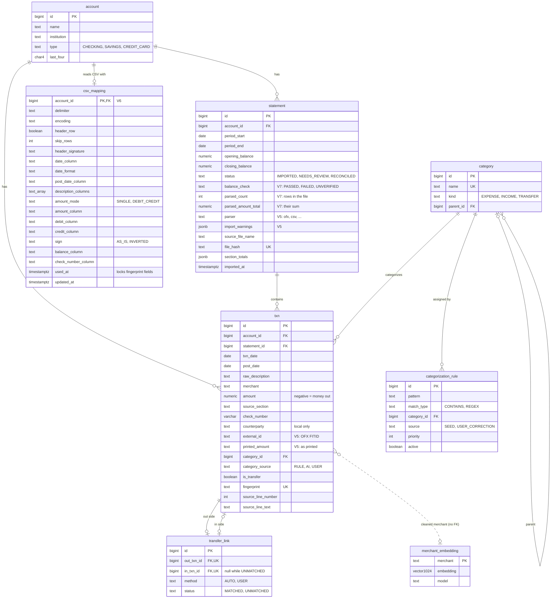
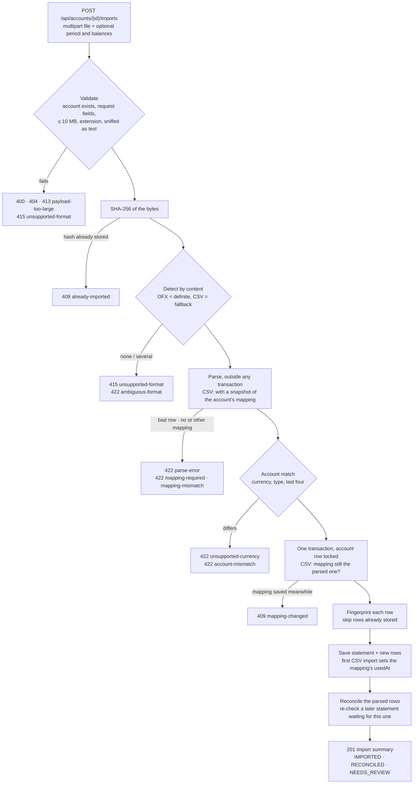

# Finalysis

Local-first personal financial analytics: import bank and card statements, categorize spending,
and ask questions about your own data. Spring Boot backend + React (Vite, TypeScript) frontend.
Features and their status are tracked in [docs/requirements.md](docs/requirements.md).

```
backend/      Spring Boot 4 REST API (Java 21, Maven wrapper) — runs on :8080
frontend/     React 19 + Vite app — runs on :5173, proxies /api to :8080
sample-data/  Synthetic bank and card statements (see "Sample data")
postman/      Postman collection and local environment for the API
scripts/      Developer scripts (dev database reset)
tools/        Sample data generator
compose.yaml  Postgres 17 + pgvector
```

## Local development

**Prerequisites:** JDK 21+, Node.js 22+, Docker (for the database and for Testcontainers).

```sh
cp .env.example .env          # then set POSTGRES_PASSWORD
docker compose up -d db

# Terminal 1 — backend (Flyway applies migrations at startup)
cd backend
./mvnw spring-boot:run

# Terminal 2 — frontend
cd frontend
npm install
npm run dev
```

Open http://localhost:5173. The page calls `GET /api/status` and shows the backend status.

### Tests

```sh
cd backend && ./mvnw verify
cd frontend && npm test
```

Backend tests always run against a throwaway Testcontainers Postgres and never touch the dev
database. `DevDatabaseGuard` fails any test context whose datasource points at the compose database.

### Postman

`postman/` holds a collection with tests for every endpoint and a local environment
(`baseUrl` = `http://localhost:8080`). It runs top to bottom against a **freshly reset** dev
database: **1. Setup** creates the four sample accounts, saves the Apex mapping by hand and the
Summit mapping from the preview's suggestion, and imports four statements (two `IMPORTED`, one
`RECONCILED`, one `NEEDS_REVIEW`); folders 2 to 5 read accounts, mappings, previews, statements
and categories; **6. Errors** sends a request for each error the sample files can trigger;
**7. Real-file test** is for your own files (below).
Setup is strict, so a second run without a reset fails.

```sh
scripts/reset-dev-db.sh                    # wipes the dev database; see below
(cd backend && ./mvnw spring-boot:run)     # in another terminal
npx newman run postman/Finalysis.postman_collection.json \
    -e postman/Finalysis-Local.postman_environment.json --working-dir . \
    --folder "1. Setup" --folder "2. Accounts" --folder "3. CSV mappings and preview" \
    --folder "4. Statements" --folder "5. Categories" --folder "6. Errors"
```

Run newman from the repo root: uploads use paths such as `sample-data/ofx/…`. In the Postman app,
import both files, select the **Finalysis Local** environment, set the working directory
(Settings → General) to the repo root, and run the collection with the **Collection Runner**.
`payload-too-large`, `unsupported-currency`, `ambiguous-format` and `mapping-changed` need files
or timing the sample data can't provide; the backend tests cover them.

The `--folder` flags leave out **7. Real-file test**, which is for manual runs with your own
statement: in the Postman app, select the file in **Preview real file** and **Import real file**,
send the six requests in order, and read the results in the Postman console. It asserts nothing;
untick it in the Collection Runner.
Real statements stay in `private-data/`; don't save a file selection or response into the collection.

### Database client

To browse the dev database with DBeaver or a similar client, create a PostgreSQL connection with
host `localhost`, port `POSTGRES_PORT` (default 5432), database `POSTGRES_DB`, and user and password
from `.env`. The port is bound to 127.0.0.1 only. Tick **Read-only connection** (in DBeaver, on the
connection's General page): the schema belongs to Flyway and the data to the app.

### Resetting the dev database

> ⚠️ **`scripts/reset-dev-db.sh` permanently deletes all local data:** every account, statement,
> and transaction in the dev database. There is no undo.

```sh
scripts/reset-dev-db.sh
```

The script removes the compose `db` container and its `pgdata` volume, then starts a fresh empty
database. It removes only the database volume, which it resolves from `docker compose config` and
checks by its compose labels; other services and their volumes are never touched. Start the backend afterwards so Flyway re-applies the migrations. It asks you to type
`reset` to confirm. It refuses to run if it is given any arguments, if stdin is not a terminal, or
if anything suggests a non-local target: a remote `DOCKER_HOST` or Docker context, `DOCKER_CONTEXT`,
`COMPOSE_FILE`, `COMPOSE_PROJECT_NAME` or `SPRING_DATASOURCE_URL` set, or a `POSTGRES_HOST` other
than localhost.

## Data model

Postgres 17 with pgvector. The schema is owned by Flyway (`backend/src/main/resources/db/migration`).
Hibernate only validates it. Requirements: DAT-01 to DAT-08 in [docs/requirements.md](docs/requirements.md).
Columns added by Phase 3a's migrations are marked V5, V6 and V7 below.



| Table | Purpose |
|---|---|
| `account` | A checking, savings, or credit card account. Only the last four digits of the account number are stored. |
| `statement` | One imported statement file for one account and period, with its opening and closing balances, printed section totals, status and balance-check outcome, and the parsed row count and total (duplicates included) that reconciliation uses. A file hash blocks importing the same file twice; a re-imported period is deduplicated row by row. `parser` records which parser read the file. |
| `category` | Seeded spending and income categories, each with a kind. `TRANSFER` covers all movement between the user's own accounts. |
| `txn` | One statement row: dates, raw description, cleaned merchant, signed amount, category and who set it, and where it came from in the source file. |
| `csv_mapping` | How to read one account's CSV exports: delimiter, encoding, table start, which columns hold the date, description, amount (single or debit/credit), balance and check number, and the sign. `used_at` is set by the first import that uses it, which locks the fields that feed fingerprints. |
| `categorization_rule` | Merchant pattern → category rules. Rules run before any AI, and user corrections become new rules. |
| `transfer_link` | Pairs the outgoing and incoming side of a transfer between the user's own accounts, such as a card payment. |
| `merchant_embedding` | One embedding per cleaned merchant name, used to find similar merchants for categorization and search. |

### Design decisions

- **`txn_date` vs `post_date`.** `post_date` is the date printed in the statement's date column.
  `txn_date` is when the purchase happened: a date embedded in the description
  (`CHECKCARD 0704 …`) if there is one, otherwise the posting date. Analytics group by `txn_date`.
- **Two-level reconciliation.** Each row records the statement section it was printed in
  (`source_section`: deposit, withdrawal, check, fee, …), and `statement.section_totals` stores the
  printed total per section. Import first checks each section's rows against its printed total,
  then checks opening balance + all rows = closing balance. A missing row shows up in a specific
  section, not just as an overall mismatch.
- **Fingerprint.** `txn.fingerprint` is a SHA-256 of raw printed values only (account, printed
  date, amount, description, section) plus an occurrence number. Re-importing a statement
  reproduces the same fingerprints, so its rows are skipped, while two genuinely identical charges
  get occurrence 1 and 2 and are both kept. The OFX transaction id (`FITID`) is deliberately not
  hashed, because some institutions reissue ids on later downloads; it is kept in
  `txn.external_id` to flag possible duplicates. Derived values (merchant, category, embedded
  `txn_date`, counterparty) are excluded because they change as parsing improves. If they were
  hashed, a better parser would re-insert every old row.
- **Source tracing.** `source_line_number` and `source_line_text` record where each row came from
  in the original file, so any total can be traced back to statement lines.
- **`counterparty` is local only.** Person-to-person payees and payers (e.g. Zelle) are stored for
  the user's own use and are never sent to a cloud model.
- **`transfer_link`.** `in_txn_id` is nullable so a card payment can be marked as a transfer before
  the card's statement is imported (`status = UNMATCHED`). A CHECK constraint ties `MATCHED` to a
  non-null `in_txn_id`. The unique constraints stop a txn from appearing twice on the same side,
  and the V3 trigger also stops it from being the out side of one link and the in side of
  another, so a txn belongs to at most one link.
- **`merchant_embedding`.** One row per cleaned merchant name, not per transaction. Merchants repeat,
  so each is embedded once. `vector(1024)` is a dimension that both the cloud and the local
  embedding models produce, so both share one schema. A cosine HNSW index serves nearest-neighbour
  search. The `model` column records which model produced each vector, so rows can be re-embedded
  when the model changes.
- **Categories are bank-agnostic.** They describe the kind of spending, not any institution's own
  category labels, so one set applies to every account.

### Migrations

| Version | Purpose |
|---|---|
| V1 `init` | Initial schema: all seven tables, constraints, indexes, and the pgvector extension. |
| V2 `seed_categories` | Seeds the categories: the sample-data answer key's categories plus general-purpose ones. |
| V3 `transfer_link_txn_once` | Trigger ensuring a txn belongs to at most one transfer link, on either side. |
| V4 `account_name_lengths` | CHECK constraints limiting account name and institution to 1–100 characters. |
| V5 `statement_import` | `txn.external_id` and `printed_amount`, `statement.parser` and `import_warnings`; drops the unique (account, period) constraint so periods can be re-imported. |
| V6 `csv_mapping` | `csv_mapping`: one CSV column mapping per account, with CHECK constraints for its enums, amount columns and column indexes. |
| V7 `statement_reconciliation` | `statement.balance_check` (PASSED, FAILED, UNVERIFIED), `parsed_count` and `parsed_amount_total`, for reconciliation and late-arrival re-checks. |

Applied migrations are never edited. Every schema change is a new migration.

## API

| Method | Path | Purpose | Success | Problem types (besides 400/404) |
|---|---|---|---|---|
| `GET` | `/api/status` | Backend health, shown by the frontend | 200 | — |
| `GET` | `/actuator/health` | Liveness for tooling: `{"status": "UP"}`, no details | 200 | — |
| `POST` | `/api/accounts` | Register an account (DAT-01) | 201, `Location` | — |
| `GET` | `/api/accounts` | List accounts, sorted by name | 200 | — |
| `GET` | `/api/accounts/{id}` | Get one account | 200 | — |
| `PATCH` | `/api/accounts/{id}` | Rename an account (only `name`) | 200 | — |
| `GET` | `/api/categories` | List the seeded categories (DAT-02) | 200 | — |
| `GET` | `/api/accounts/{id}/csv-mapping` | Get the account's CSV mapping; 404 when it has none | 200 | — |
| `PUT` | `/api/accounts/{id}/csv-mapping` | Create or replace the CSV mapping; `?confirmFingerprintChange=true` accepts a change to a locked field. See [CSV mappings](#csv-mappings) | 201 created, 200 replaced | `mapping-locked` |
| `POST` | `/api/accounts/{id}/imports/preview` | Read a file as an import would and write nothing; CSV gets a suggested mapping. See [Preview](#preview) | 200 | `payload-too-large`, `unsupported-format`, `ambiguous-format`, `parse-error`, `account-mismatch`, `unsupported-currency` |
| `POST` | `/api/accounts/{id}/imports` | Import a statement file (multipart `file`; optional `periodStart`, `periodEnd`, `openingBalance`, `closingBalance`). See [Importing statements](#importing-statements) | 201, `Location` | all import types: see the [error catalogue](#error-catalogue) |
| `GET` | `/api/accounts/{id}/statements` | List the account's statements, newest period first; `?status=IMPORTED\|RECONCILED\|NEEDS_REVIEW` filters | 200 | — |
| `GET` | `/api/statements/{id}` | Get one imported statement with its warnings | 200 | — |

- **Money is a string.** Every money field in a response is a JSON string with exactly two
  decimals (`"closingBalance": "4066.58"`), and money in a request must be such a string; a JSON
  number gets a 400 naming the field. JavaScript reads JSON numbers as binary floating point, which
  can lose cents.
- **Strict bodies.** Request bodies reject unknown fields. `PATCH /api/accounts/{id}` accepts only
  `name`, so trying to change the type or last four digits returns a 400 that names the field.
  Accounts cannot be deleted.
- **Errors** are RFC 9457 problem details (`application/problem+json`). Validation errors add an
  `errors` list of `{field, message}`:

  ```json
  {
    "title": "Invalid request",
    "status": 400,
    "detail": "One or more fields are invalid",
    "instance": "/api/accounts",
    "errors": [
      { "field": "lastFour", "message": "must be exactly 4 digits" },
      { "field": "name", "message": "must not be blank" }
    ]
  }
  ```

### Error catalogue

Typed problems have a `type` of `urn:finalysis:problem:<name>`; the others use the default
`about:blank`. No problem response quotes file contents, descriptions, file names or account
numbers (SEC-10). Constraint names, SQL and stack traces are logged on the server and never
returned.

| Status | `type` | Meaning | What to do |
|---|---|---|---|
| 400 | — | Invalid field, unknown field (`"is not allowed"`), bad enum value (lists the allowed values), a JSON number for money, a balance form field with more than two decimals, an inverted period. `errors[]` names each field | Fix the named fields and resend |
| 400 | — | Malformed JSON, or a non-numeric id | Send valid JSON and numeric ids |
| 404 | — | Unknown id (`Account 42 not found`), or an account without a CSV mapping on `GET …/csv-mapping` | Check the id with `GET /api/accounts`; save a mapping first |
| 405, 415 | — | Wrong HTTP method, or a JSON/multipart body sent where the other is expected (Spring's own errors, same format) | Use the method and body type from the API table |
| 409 | — | A database constraint was violated; generic `detail` | Should not happen through the API; check the server log and report it |
| 409 | `mapping-locked` | A used CSV mapping's fingerprint fields (sign, description columns, printed-date column) would change; `fields[]` lists them | If the change is intended, resend with `?confirmFingerprintChange=true`; overlapping re-imports will then add rows again and need review |
| 413 | `payload-too-large` | File over 10 MB | Export a shorter date range |
| 415 | `unsupported-format` | Disallowed extension, empty, PDF, ZIP/XLSX, saved web page, binary or invalid text, or no parser recognizes the content | Download the statement as OFX, QFX or CSV (PDF support comes in Phase 3b) |
| 409 | `already-imported` | This exact file was imported before; `statementId` names it | Nothing to do: open that statement |
| 422 | `parse-error` | A row or the file structure can't be read; `line` (and the column position for CSV) when known. Nothing was written | Check that the file wasn't edited or cut short and download it again. For CSV, check the mapping's `dateFormat`, amount columns and `skipRows` against the [preview](#preview); footer rows are a [known limitation](#known-limitations) |
| 422 | `account-mismatch` | The file's account type or last four digits differ from the account's | Upload it to the account it belongs to |
| 422 | `unsupported-currency` | The statement isn't in USD | Not supported yet |
| 422 | `mapping-required` | A CSV file for an account without a CSV mapping; `detail` points to the preview | Preview the file, check `suggestedMapping.mapping`, `PUT` it, import again |
| 422 | `mapping-mismatch` | The CSV file's columns differ from the mapping's; `preview` holds its headers, mapping status and a suggested mapping, no rows | Check it's the right account. If the bank changed its export, `PUT` the suggested mapping (confirm if locked fields change) |
| 409 | `mapping-changed` | The CSV mapping was saved while the file was being read; nothing was written | Import again |
| 422 | `ambiguous-format` | More than one parser claims the file: a detection bug, never guessed | Report it (with the file's format, not the file) |
| 500 | — | Unexpected error; generic `detail` | Check the server log (it holds no statement data) and report it |

## Importing statements

Upload one statement file per request to the account it belongs to. Supported today: OFX
1.x/2.x, QFX and CSV; PDF follows in Phase 3b. Optional form fields: `periodStart` and
`periodEnd` (ISO dates) replace the file's period; `openingBalance` and `closingBalance` are the
statement's balances as printed on paper, for files that don't carry them (card CSV exports), and
are checked against the rows (see [Reconciliation](#reconciliation)). If the file prints a
balance and the request disagrees, the file's value is kept and the check fails. Balances are
plain decimal text such as `1234.56`: at most two decimals, no exponent or thousands separator.

### Pipeline



1. **Validate.** The account must exist and the request fields be well formed. At most 10 MB;
   the file name must end in `.ofx`, `.qfx`, `.csv` or `.txt`; the bytes must be UTF-8 or
   windows-1252 text (PDFs, ZIP/XLSX, web pages and binary data are refused). The client's
   content type is ignored. Uploads are held in memory and discarded after parsing; only a
   SHA-256 hash, the file name and each row's source line are kept.
2. **Hash.** The same file again (same hash) is `409 already-imported` with the existing
   `statementId`.
3. **Detect and parse** by content, outside any database transaction. Any unreadable row fails
   the whole file (`422 parse-error`, with the line number); nothing is written. A CSV file is
   read with a snapshot of the account's mapping, taken just before parsing.
4. **Account match.** The file's currency, last four digits and account type must match the
   account when the file carries them.
5. **Save** in one transaction, with the account row locked so imports to one account run one
   at a time. A CSV import first checks that the mapping is still the one it parsed with (a
   mapping saved in the meantime is `409 mapping-changed`; retry), and the first import that
   uses a mapping sets its `usedAt`. Each row is fingerprinted from its raw values; rows already
   imported for this account are skipped as duplicates, so re-importing a period or an
   overlapping export adds only rows that are new.
6. **Reconcile** the rows parsed from the file against the balances (see
   [Reconciliation](#reconciliation)), then answer with the import summary.

### Walkthrough

**OFX or QFX.** Download the statement as OFX/QFX (often called "Quicken" or "Money") and upload
it. Nothing else is needed: the file names the account, the period and the closing balance.

```sh
curl -F file=@sample-data/ofx/northfield-checking_2026-04.ofx http://localhost:8080/api/accounts/1/imports
```

```json
{
  "statementId": 1, "parser": "ofx", "periodStart": "2026-04-01", "periodEnd": "2026-04-30",
  "openingBalance": null, "closingBalance": "4066.58",
  "parsed": 10, "inserted": 10, "duplicates": 0, "status": "IMPORTED", "balanceCheck": "UNVERIFIED",
  "warnings": ["balance unverified: nothing to check the rows against (send openingBalance and closingBalance, or import the previous statement)"]
}
```

The first statement of an account is `IMPORTED`: OFX prints only the closing balance, so there is
nothing to check it against yet. Importing May then checks April's closing + May's rows = May's
closing and gives `RECONCILED`; importing them in the other order works too (late arrival).

**CSV.** CSV exports differ by bank, so the account needs a column mapping, saved once:

```sh
# 1. Preview: how the file will be read, plus a suggested mapping. Writes nothing.
curl -F file=@sample-data/statements/apex-visa_2026-04.csv \
     http://localhost:8080/api/accounts/3/imports/preview > preview.json

# 2. Check suggestedMapping (confidence MATCHED / GUESSED / MISSING, notes), edit if needed, save it.
jq .suggestedMapping.mapping preview.json > mapping.json
curl -X PUT http://localhost:8080/api/accounts/3/csv-mapping \
     -H 'Content-Type: application/json' -d @mapping.json

# 3. Import. A card CSV has no balances, so send the ones printed on the statement.
curl -F file=@sample-data/statements/apex-visa_2026-04.csv \
     -F openingBalance=-842.17 -F closingBalance=-242.32 \
     http://localhost:8080/api/accounts/3/imports
```

Later CSV imports of the account reuse the mapping. Without one, an import is
`422 mapping-required`; a file whose columns differ from the mapping's is
`422 mapping-mismatch`, with the file's headers and a suggested mapping (no data rows). A CSV file
without rows imports as an empty statement when the request gives both `periodStart` and
`periodEnd`. A CSV with a balance column (Northfield) reconciles row by row without sending
balances.

**Statuses.**

| `status` | `balanceCheck` | Meaning | What to do |
|---|---|---|---|
| `RECONCILED` | `PASSED` | At least one balance check ran, all passed, and nothing needs review | Nothing |
| `IMPORTED` | `UNVERIFIED` | Saved, but no check could run (no balances, no adjacent earlier statement); warning `balance unverified: …` | Send `openingBalance` and `closingBalance` next time, or import the previous statement: an OFX statement is re-checked when its predecessor arrives |
| `NEEDS_REVIEW` | any | Saved with the reasons in `warnings` | Read the warnings (`GET /api/statements/{id}`) |

**What lands in review.** `NEEDS_REVIEW` whenever any of these happened; it wins over
`RECONCILED`:

- a balance check failed (see [Reconciliation](#reconciliation));
- the parser warned, for example an OFX `TRNTYPE` that contradicts the amount's sign;
- rows are dated outside the statement period (for example after a `periodEnd` override); they
  are imported anyway, never dropped;
- the period overlaps an earlier statement of the account and the import added rows
  (`period overlaps statement 7`). A re-import that adds nothing only gets the informational
  warning `period overlaps statement 7; no new rows`, which doesn't block `RECONCILED`;
- the account mixes import formats (`account mixes import formats (...)`, see
  [Known limitations](#known-limitations));
- a new row reuses an OFX `FITID` that the account already has under different details. That row
  is inserted anyway, since dropping it could lose a real transaction, and flagged as a possible
  duplicate.

Statements needing review are listed by `GET /api/accounts/{id}/statements?status=NEEDS_REVIEW`.
Everything is saved either way; the review-queue API (resolving a statement) comes in Phase 3c.
Warnings contain line numbers, counts, ids and balance-check amounts, never descriptions or
account numbers.

**Look-alike rows are kept.** Two purchases with the same amount at the same store on the same
day are both imported, and a refund is its own row. Deduplication only skips a row imported
before: rows are matched by their printed values plus an occurrence number within the statement
(the first identical row is 1, the next 2), so re-uploading a file finds every row again while two
real purchases stay separate.

### Reconciliation

Every import checks the statement's balances against **the rows parsed from the file**, duplicates
included (the rows it inserts skip duplicates, so they can't add up). Java `BigDecimal` does the
arithmetic. Each check runs when its inputs exist:

| Check | When | Rule |
|---|---|---|
| Request balances | both `openingBalance` and `closingBalance` sent | opening + rows = closing |
| Balance column | the CSV mapping has a balance column | each row's balance = the previous balance + its amount. Newest-first files (first date after the last) are checked in reverse. Opening = first balance − first amount, closing = last balance; a balance-only opening row and sent balances must agree with them |
| Continuity | a closing balance without an opening one (OFX `LEDGERBAL`) | the previous statement's closing + rows = closing, when the account's latest earlier statement ends the day before this one starts (or that day). The opening is then the previous closing; it is never derived from `LEDGERBAL` alone |
| Section totals | the file prints totals per section (PDFs, Phase 3b) | each total = the sum of its section's rows; a total for a section without rows must be 0 |
| Printed balances | the file prints both balances (PDFs) | opening + rows = closing |

The outcome is `balanceCheck`: `PASSED` (at least one check ran, all passed → `RECONCILED`),
`FAILED` (→ `NEEDS_REVIEW`) or `UNVERIFIED` (none could run → `IMPORTED` with a
`balance unverified` warning). A failed check adds a warning with the check, the expected amount
(what the arithmetic gives), the actual one (as printed or sent) and the difference:

```
reconciliation failed: continuity: statement 7's closingBalance + rows = closingBalance: expected 8236.77, actual 8246.77, difference 10.00
reconciliation failed: balance column, line 5: expected 2458.91, actual 2459.91, difference 1.00
```

Failing balance-column rows are listed up to 10, then counted. Amounts in warnings go back to
the user only and are never logged.

**Late arrivals.** OFX statements imported out of order still reconcile: when May arrives first,
it is unverified; when April arrives, May's continuity check runs again in the same transaction,
and May becomes `RECONCILED` (with April's closing as its opening) or `NEEDS_REVIEW`. A May that
needs review for another reason stays `NEEDS_REVIEW`.

**Statements.** `GET /api/accounts/{id}/statements` lists an account's statements, newest period
first, with `id`, `parser`, `periodStart`, `periodEnd`, `openingBalance`, `closingBalance`,
`status`, `balanceCheck`, `parsedCount` (rows in the file), `transactionCount` (rows it owns),
`warningCount` and `importedAt`. `?status=NEEDS_REVIEW` (or `IMPORTED`, `RECONCILED`) filters.
`GET /api/statements/{id}` adds the warnings. The review queue (ING-07) comes in Phase 3c.

### Preview

`POST /api/accounts/{id}/imports/preview` takes the same multipart `file` and runs the same upload
checks, detection and parsing as an import, but writes nothing. An OFX/QFX file returns
`format`, `periodStart`, `periodEnd` and `transactionCount`. A CSV file returns how it will be
read, with a suggested mapping unless the saved one already matches:

```json
{
  "format": "csv", "delimiter": ",", "encoding": "UTF-8", "skipRows": 0,
  "headers": ["Transaction Date", "Post Date", "Description", "Category", "Amount"],
  "rows": [["2026-04-03", "2026-04-04", "AMZN MKTP US*7ETP43", "Merchandise", "66.43"], "…"],
  "mappingStatus": "NONE",
  "suggestedMapping": {
    "mapping": { "headers": ["…"], "dateColumn": "Transaction Date", "postDateColumn": "Post Date",
                 "dateFormat": "yyyy-MM-dd", "descriptionColumns": ["Description"],
                 "amountMode": "SINGLE", "amountColumn": "Amount", "sign": "INVERTED", "…": "…" },
    "confidence": { "dateColumn": "MATCHED", "dateFormat": "MATCHED", "postDateColumn": "MATCHED",
                    "descriptionColumns": "MATCHED", "amountColumn": "MATCHED", "sign": "GUESSED" },
    "notes": ["sign: 6 of 7 amounts are positive, so purchases look positive (INVERTED)"]
  }
}
```

- `rows` are the first 10 data rows. `mappingStatus` is `NONE` (no mapping), `MATCHES` (the saved
  mapping reads this file) or `MISMATCH`.
- **Detection** finds the table even below a preamble (summary lines, a summary block with its
  own header, blank lines). Among the runs of consecutive records sharing one column count of 2
  or more (blank lines skipped), starting within the first 100 lines, with `,` `;` tab or `|`,
  the run with the most records is the table; a tie goes to the later run. Its first line
  becomes `skipRows`, counting blank lines. A table shorter than a summary block above it is
  found at the block: check `skipRows` in the preview. The encoding is UTF-8 when the bytes are
  valid UTF-8, else windows-1252.
- **Suggestions** are plain Java, no AI. Headers match known names ignoring case, spaces and
  punctuation (`Trans. Date`, `Posting Date`, `Merchant Name`, `Debit`/`Credit`, `Money Out`,
  `Running Balance`, `Running Bal.`, `Bal`, `Check No`, …). With both a transaction and a post date, the post date is
  the printed date. The date format is the first of `MM/dd/yyyy`, `M/d/yyyy`, `yyyy-MM-dd`,
  `dd-MMM-yyyy`, `MM/dd/yy`, `dd/MM/yyyy` that reads every date in the file; if another one also
  does but gives different dates (04/05 as April 5 or May 4), the US format is picked with an
  "ambiguous date format" note. A card account with one amount column gets `INVERTED` when most
  amounts are positive. Each field is `MATCHED`, `GUESSED` or `MISSING`; `mapping` is a ready
  `PUT` body, and nothing is saved until you send it.
- The preview contains file contents, so it is returned to the uploader only and never logged.

### CSV mappings

CSV exports differ by bank, so each account saves one column mapping, which every CSV import of
that account uses. The [preview](#preview) suggests one; this is what the Apex Visa export needs:

```sh
curl -X PUT http://localhost:8080/api/accounts/3/csv-mapping -H 'Content-Type: application/json' -d '{
  "headers": ["Transaction Date", "Post Date", "Description", "Category", "Amount"],
  "dateColumn": "Transaction Date", "dateFormat": "yyyy-MM-dd", "postDateColumn": "Post Date",
  "descriptionColumns": ["Description"],
  "amountMode": "SINGLE", "amountColumn": "Amount", "sign": "INVERTED"
}'
```

| Field | Notes |
|---|---|
| `headers` | The file's header names (from the preview). Required with a header row; every column below must be one of them, exactly, and the server computes `headerSignature` from them. |
| `headerRow`, `columnCount` | `headerRow` defaults to `true`. Without a header row, columns are zero-based indexes written as strings (`"0"`), checked against `columnCount`. |
| `delimiter`, `encoding`, `skipRows` | Defaults `,`, `UTF-8`, `0`. The delimiter is one character (not `"` or a line break); the encoding is `UTF-8`, `windows-1252` or `ISO-8859-1`; up to 100 lines are skipped before the header. |
| `dateColumn`, `dateFormat`, `postDateColumn` | A strict pattern with a year, month and day, such as `MM/dd/yyyy` or `dd-MMM-yyyy`. The post date is optional. |
| `descriptionColumns` | One to ten columns, joined in this order with one space. |
| `amountMode` | `SINGLE` with `amountColumn`, or `DEBIT_CREDIT` with `debitColumn` and `creditColumn` (and no `amountColumn`). |
| `sign` | `AS_IS` or `INVERTED` (the file prints money out as positive). Required for credit card accounts, `AS_IS` by default otherwise. |
| `balanceColumn`, `checkNumberColumn` | Optional. With a balance column, a row with a valid date and a balance but no amount (blank amount, or blank debit and credit) is a balance-only row, not a transaction: the oldest row (the first, or the last in a newest-first file) is the statement's opening balance; anywhere else it is skipped with a warning naming its line. Judged by the cells alone, never the description. Without a balance column, an empty amount is a `parse-error`. |

A column can serve only one role. Errors are 400s naming the field (`descriptionColumns[1]`), never
the column names themselves. The response echoes the mapping with `headerSignature`, `usedAt`,
`createdAt`, `updatedAt` and `warnings`.

**Fingerprint lock.** CSV rows are fingerprinted from the printed date, the description columns
and the sign-normalized amount. Once an import has used the mapping (`usedAt` is set), changing
those inputs would give earlier rows new fingerprints, and an overlapping re-import would add them
again. So these fields are locked:

- `sign`;
- `descriptionColumns`: which columns, and their order;
- the printed-date column: `postDateColumn` when present, otherwise `dateColumn`.

Locked values are compared exactly, so renaming one of these columns also counts. A `PUT` that
changes one returns `409 mapping-locked` with `fields` listing them. Repeating it with
`?confirmFingerprintChange=true` saves the change, and the response warns that future imports
overlapping earlier statements will produce new fingerprints and land in `NEEDS_REVIEW`.
Everything else stays editable after use, because it only locates or parses values: other
columns (amount, debit and credit, the transaction date when a post date is mapped), the amount
mode, `dateFormat`, `delimiter`, `encoding`, `headerRow`, `skipRows`, the balance and check-number
columns, and the header signature.

### Known limitations

- **One format per account.** Duplicates are recognized only within one format: the same
  transaction exported as CSV and as OFX has different descriptions and dates, so it would be
  imported twice. Pick one format per account; an import that mixes formats on an account is
  flagged for review.
- **Footer rows in CSV.** A trailing total or footer row (`Total,,1234.56`) fails the import with
  `422 parse-error` at that line. Remove it before importing; a `skipFooterRows` mapping option
  will be added if a real bank export needs it.
- **CSV fingerprints use the sign-normalized amount**, not the printed one: files with separate
  debit and credit columns have no single printed signed amount. The mapping lock protects this;
  changing a locked field with confirmation gives later rows new fingerprints, so an overlapping
  re-import adds them again and needs review.
- **Institutions that reissue FITIDs.** Deduplication uses printed values, not the OFX `FITID`,
  so a reissued id doesn't duplicate a row. The flip side: the possible-duplicate check (a known
  `FITID` with new details) only helps where ids are stable. At an institution that reissues them,
  a row whose printed details changed between downloads is imported again without a flag.
- **Descriptions may contain identifiers.** Descriptions are stored exactly as printed (they feed
  the fingerprint), so a full account number in an OFX `NAME`/`MEMO`, a masked number in a
  transfer description or a person's name in a Zelle payment stays in `raw_description`. They are
  never logged or returned in errors, and no AI runs yet; SEC-08 redacts them before any cloud
  call in Phase 4.
- **File bytes are discarded** after parsing until encrypted storage (SEC-04, Phase 8). Only the
  hash, the file name and each row's source line are kept, so a statement can't be re-parsed or
  downloaded later; import the original file again instead.
- **Not yet:** PDF statements (Phase 3b), transfer detection and the review-queue API (Phase 3c),
  merchant cleaning and categorization (Phase 4), non-USD statements.

## Security

Statement files are untrusted input and hold personal data, so uploads are hardened (SEC-10):

- **Limits.** 10 MB per file (the multipart limit and a check in code), 50,000 CSV rows and
  64 KB per CSV record; OFX nesting, tag, value and element counts are bounded.
- **Content sniffing.** The client's content type is ignored. The extension must be `.ofx`,
  `.qfx`, `.csv` or `.txt` (`statement.csv.exe` is refused), and the bytes must be UTF-8 or
  windows-1252 text: PDFs, ZIP containers (XLSX), saved web pages, executables, NUL bytes,
  UTF-16 and invalid text get `415 unsupported-format`. Formats are then detected by content.
- **No XML parser, no XXE.** OFX is read by an in-house tokenizer that rejects DTDs, entity
  declarations (general, parameter and external), comments, CDATA and processing instructions in
  the body, so external entities and entity expansion (billion laughs) can't happen.
- **Nothing on disk.** The multipart threshold is above the size limit, so uploads stay in memory
  and are discarded after parsing. Kept: the SHA-256 hash, each row's source line, and the file
  name without path, control or format characters (at most 255 characters, extension kept).
- **No statement data in logs or errors.** Logs carry ids, counts, statuses and parser ids.
  Problem responses carry line numbers, column positions, field names, counts and sizes, never
  cell values, descriptions, file names or account numbers. The one exception is
  `422 mapping-mismatch`, whose preview shows the file's header names so the mapping can be
  fixed. Postgres error details (which quote the failing row) are turned off on the connection.
- **Little exposure.** Actuator exposes `health` only, without details; there is no CORS policy
  (the frontend reaches the API through the Vite proxy); devtools may not turn on error details
  or exception logging under `spring-boot:run`.
- **Formula cells (SEC-11).** Descriptions starting with `=`, `+`, `-`, `@`, a tab or a carriage
  return are stored unchanged; any future CSV export must escape them.

Don't raise `org.springframework.web` or `org.hibernate` logging to DEBUG or TRACE with real
statements: the framework then logs request and response bodies and SQL bind values. The app's
own packages (`com.finalysis`) are safe at DEBUG. These rules are covered by
`SensitiveDataLeakTest`, `UploadHardeningTest`, `MultipartDiskTest` and `ExposureTest`.

## Sample data

`sample-data/` holds fully synthetic statements for six months (April 1 – September 30, 2026).
Every institution, account number, and employer is fictional. Merchant strings imitate real
card descriptors (`SQ *BLUE BEAN CAFE 4412`, `AMZN MKTP US*2K4L91`) so categorization is realistic.

| Account | Format | Statement period |
|---|---|---|
| Northfield Bank Checking (…1001) | `Date,Description,Debit,Credit,Balance`, `MM/DD/YYYY` | calendar month |
| Northfield Bank Savings (…1002) | same as checking | calendar month |
| Apex Rewards Visa (…2001) | `Transaction Date,Post Date,Description,Category,Amount`, `YYYY-MM-DD`, purchases positive | 15th – 14th, named by closing month |
| Summit Cash Card (…3001) | `Trans. Date,Merchant Name,Amount`, `DD-Mon-YYYY`, purchases negative | calendar month |

- `statements/` — one CSV per account per statement period, e.g. `apex-visa_2026-04.csv`.
  The first and last Apex cycles extend past the data range, so they are only partly filled.
- `answer-key.csv` — every transaction with its normalized amount (negative = money out),
  expected category, `is_transfer`, and anomaly tag. Savings transfers and card payments are
  transfers on both sides; card payments appear in checking and on the card 1–3 days apart,
  with different descriptions.
- `statements-manifest.csv` — period and opening/closing balance per statement, in the same
  sign convention (card balances owed are negative), so `opening + sum(amounts) = closing`.
- `broken/summit-card_2026-06.csv` — the June Summit statement with one transaction missing.
  Its manifest balances are correct, so it does not reconcile; use it to test the review queue.
- `ofx/` — the same Northfield checking statements as OFX 1.x SGML (`CHARSET:1252`, CRLF, empty
  `MEMO`s) and the same Apex statements as QFX (OFX 2.x XML). Descriptions longer than 32
  characters are split at a space into `NAME` and `MEMO`, so `NAME MEMO` equals the CSV description.
- `edge-cases/` — hand-built files for parser and import tests. OFX: a `TRNTYPE` that
  contradicts the sign, a `LEDGERBAL` that doesn't match the rows, an XXE payload, and a transfer
  with a `BANKACCTTO` account number. CSV: quoted cells (commas, line breaks, doubled quotes, BOM,
  non-ASCII), formula-leading descriptions, identical same-day rows, a card refund, a newest-first
  file, windows-1252, a Northfield export for 04-15 to 05-14 overlapping two statements, and the
  April checking statement below a four-line summary and a blank line (`csv-preamble.csv`), and a
  checking export below a five-record summary block, whose first row is a balance-only opening
  row (`csv-summary-preamble-balance-row.csv`). Not in the answer key.

**Planted anomalies**

| Anomaly | Where | Answer-key tag |
|---|---|---|
| Music subscription price increase | `SPOTIFY USA` $11.99 → $12.99 from July | `price_increase` |
| Duplicate charge | `SAFEWAY #1234` $84.12 twice on June 13 (Apex) | `duplicate` |
| Unusually large purchase | `BEST BUY` $899.99 on August 22 (Apex), ~10x a normal shopping trip | `large_purchase` |
| Rising dining spend | Summit dining totals increase every month | — (trend) |
| Missing bill | No `SKYWAVE INTERNET` payment in September | — (absent row) |

**Regenerating.** Output is byte-identical on every run (fixed seed and dates). From the repo root:

```sh
java tools/SampleDataGenerator.java
```

`SampleDataTest` runs the generator into a temporary directory and fails if any file differs from
what is committed (CI does the same once it is active). It also checks that every statement reconciles with the manifest, the broken one does not, every card payment
has a matching checking transfer, and the answer key matches the statements.

## License

[MIT](LICENSE)
